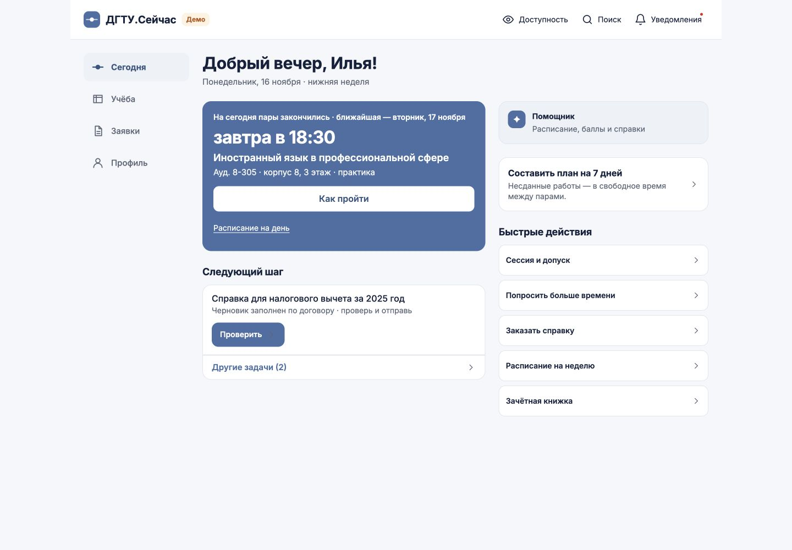
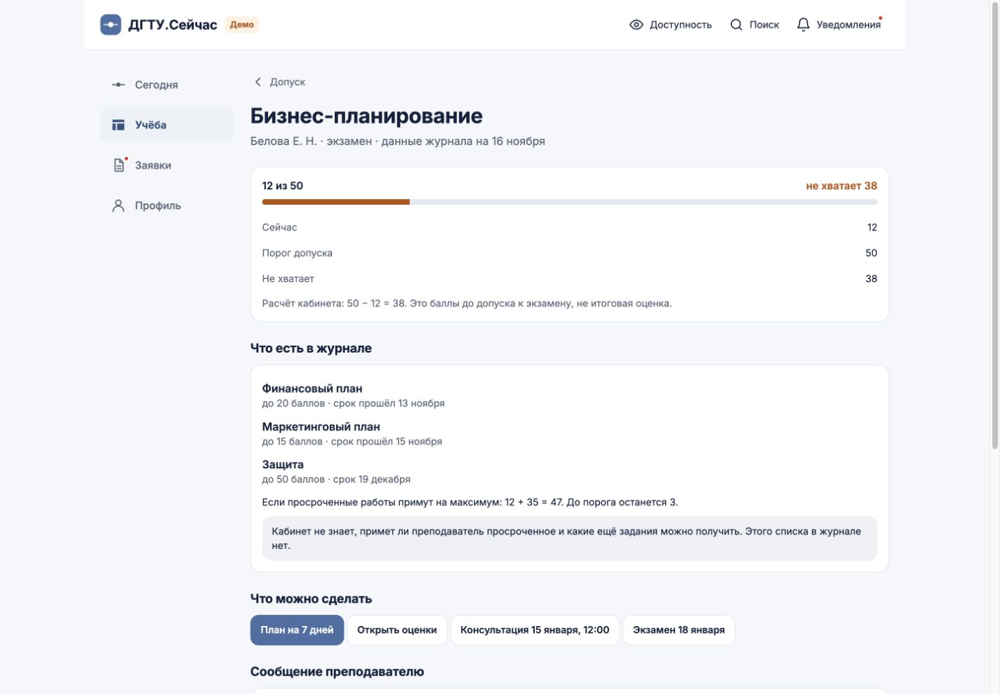
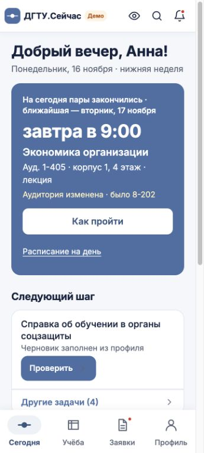
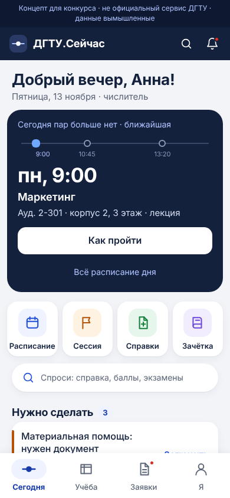

# ДГТУ.Сейчас

Цифровой деканат будущего
Описание процесса создания с помощью ИИ

Капитан команды: Ксения Игоревна Палеева.
Версия материалов: 16 ноября 2026 года.

Кабинет помогает студенту понять, что происходит с учёбой и какой следующий шаг нужен: где ближайшая пара, хватает ли баллов, за кем действие по заявке.

Концепт для MGIMO AI Challenge. Не официальный сервис ДГТУ. Все данные студентов, преподавателей, оценок и документов в прототипе вымышленные.

Прототип: https://zabava204-dgtu-seychas-e35f.twc1.net/
Исходники: https://github.com/zabava204/dgtu-seychas
Опубликованная основа: 2c3c753; новая главная показана как подготовленная доработка.

| Аккаунт | Что показывает |
| --- | --- |
| anna / demo2026 | Бакалавриат, 3 курс, бюджет. Дневные пары, баллы и допуск. |
| ilya / demo2026 | Магистратура, 2 курс, договор. Вечерние пары, НИР и справка для вычета. |
| dekanat / demo2026 | Рабочее место сотрудника: очередь, документы, переписка и PDF. |

На странице входа есть кнопки демо-доступа. Данные общие для проверяющих. При необходимости сценарий возвращается к началу через «Профиль» → «Демонстрационный режим»; сброс затрагивает все демо-аккаунты.

Содержание

Два сценария; архитектура помощника; воспроизводимая оценка; четыре отзыва; обязательное ядро; инструменты и промпты; ошибки; безопасность; операционный план; история макетов.

## Илья: от следующего шага до PDF

Подготовленная главная, локальная копия: готовый черновик предлагается как следующий шаг.

Илья открывает «Сегодня» → «Следующий шаг» → «Проверить». Данные справки уже собраны по договору; остаётся проверить год и отправить. На опубликованной основе этот же вход расположен в блоке «Требует внимания».

Сотрудник открывает заявку → «Взять в работу» → «Сформировать PDF-справку». Илья получает файл в заявке и уведомление. Вместо похода между разными разделами виден путь, за кем действие и где результат.

Если черновика уже нет: «Заявки» → «Новая заявка» → справка для вычета. Перед повторным демо можно вернуть исходное состояние; сброс общих данных требует согласования с другими проверяющими.

## Анна: расчёт допуска становится действием

Проверенный разбор: 12 из 50, не хватает 38; после двух работ на максимум останется 3.

Маршрут: «Сегодня» → «Другие задачи» → «Разобраться» у бизнес-планирования. Стабильный запасной вход: «Учёба» → «Оценки». В первом видимом шаге может быть другой подготовленный черновик - он не удаляет риски допуска.

Кабинет показывает расчёт, текст просьбы преподавателю и план на 7 дней. Студент видит ограничения: примет ли преподаватель просроченную работу, кабинет не знает; отметка «Сделано» не меняет баллы. «Скопировано» и сообщение о создании плана уже реализованы.

## Как помощник выбирает ответ

Схема: calc → decision → llm; при отсутствии ключа или ошибке API используется fallback.

Это каскад выбора ответа, а не цепочка переписывания одного текста. Вопрос сначала распознаётся по правилам; exact-ответ (включая фиксированный словарь) возвращается из calc. Известная ситуация без exact получает decision. Только свободный вопрос other направляется в llm.

Почему числа вне модели

Прежняя ошибка «212 вместо 47» привела к изменению границы ответственности. Баллы, расписание, даты, суммы и статусы извлекает и вычисляет программа. Модель не назначает баллы и не создаёт кнопки-действия: их формирует сервер.

RAG-lite и отказоустойчивость

retrieveFacts выбирает короткие справочные блоки по вопросу. Это поиск по правилам, без векторной базы. Структурированные баллы, платежи и статусы не добавляются в эти блоки; имя, курс, группа и история диалога могут передаваться модели. Неуспешный вызов или отсутствие ключа возвращает запасной ответ по правилам.

Масштаб использования ИИ подтверждается также процессом: разработка, макеты, тексты, независимые ревью и исправленные ошибки. Наличие LLM внутри продукта само по себе не заменяет этих доказательств.

## Проверки помощника: 14 из 14

Воспроизводимый набор: node scripts/evaluate-assistant.js. Временная seeded SQLite, фиксированное время 16 ноября, 10:00 МСК; ключ удалён; http, https и fetch запрещены. Два прогона дали одинаковый JSON, сетевых попыток 0. Полный эталон и фактические ответы: docs/assistant-evals.json.

| Проверка | Пример независимого ожидания | Результат |
| --- | --- | --- |
| Арифметика | 12 + 20 + 15 = 47, до 50 остаётся 3 | Пройдено |
| Два студента | Разные дневные и вечерние пары; Илья не получает данные Анны | Пройдено |
| Оценки и НИР | Средний балл, сумма этапов и недобор по фиксированным данным | Пройдено |
| Справки | 96 000 × 0,13 = 12 480; запрет заказа за незаконченный год | Пройдено |
| Правила и язык | ЖКУ без LLM, словарь, английский вопрос, письмо без отправки | Пройдено |
| Fallback / retrieval | Неизвестный вопрос без ключа; специальные значения не уходят в справочные блоки | Пройдено |

Распределение: 11 calc, 1 decision, 1 fallback и 1 отдельная проверка retrieval. Эталоны зафиксированы по seed и независимой арифметике, не выводятся из проверяемой функции.

Границы результата

14/14 не означает точность на всех вопросах. Живой GigaChat и ветка llm не оценивались. Прямой вызов answer не проверяет HTTP-права и интерфейс: для них есть 29 автотестов и браузерный проход. Налоговый кейс проверяет арифметику демо-данных, а не полноту налоговой консультации.

## Четыре отзыва: подтверждения и разногласия

Аспирант из прежнего журнала и три студентки, чьи ответы переданы 16 ноября. Пользователь подтвердил, что два похожих ответа принадлежат разным людям. Это малый качественный набор и самоотчёты, а не репрезентативное исследование.

| Респондент | Что сообщил о прототипе | Что это меняет |
| --- | --- | --- |
| Аспирант | Задания выполнены, 5; важна ближайшая пара, список внимания кажется шумом | Проверяем постепенное раскрытие задач. |
| Бакалавриат, 2 курс | Всё выполнено; затруднение в задании б, лёгкость 3–4; на главной лишнего нет; нужен переход в портфолио | Нужно наблюдение повторного прохода б. Портфолио - развитие. |
| Бакалавриат, 1–2 курс | Всё выполнено, 5 из 5; пользовалась помощником, вся главная полезна | Сохраняем полезное содержание, улучшаем визуальную иерархию. |
| Бакалавриат, 1–2 курс | Все три задания выполнены, 5; помощник помог пройти задание; хочется интереснее интерфейс | Выразительность улучшается без расширения ядра. |

Цитаты

«Лишнего лично для меня нет» - студентка 2 курса. «Немного застряла на вопросе б» - тот же ответ. «Вся представленная информация полезна» - респондент 3. Отрицательные замечания не исключались из отчёта.

Проверяемая гипотеза: одна видимая задача уменьшит шум, остальные останутся доступны. Эти четыре ответа относятся к прежнему прототипу; новая главная ещё не прошла повторную пользовательскую проверку. Формулировка задания б и запись маршрута не предоставлены, причина затруднения не установлена.

Запрос про часы воинского учёта закрыт навигатором по официальной странице подразделения (проверка 16.11.2026), без обещания оформить отсрочку. Источник: https://www.donstu.ru/university/struktura/mobilizatsionnoye-upravleniye/

## Проблема и структура кабинета

В прежних материалах команда зафиксировала разрозненные разделы действующего кабинета: расписание, объявления, справки и оценки требуют отдельных действий. Для прототипа выбрана задача «что сделать сейчас»: ближайшее занятие и действия студента видны на главной, остальные экраны ведут к конкретному результату.

| Обязательное ядро | Реализация |
| --- | --- |
| Вход и профиль | Логин и пароль; ФИО, факультет, направление, курс, группа. Два разных студенческих аккаунта. |
| Расписание | День и неделя, преподаватель и аудитория. Изменение ведёт на конкретную дату и пару. |
| Успеваемость | Баллы, зачёты, экзамены, сессия и зачётная книжка. Разбор недобора и следующий шаг. |
| Заявки и справки | Подача, статус, сотрудник и срок; запрос документа, переписка и получение PDF. |
| Уведомления | Изменения расписания, сроки сдачи, заявки и объявления деканата. Лента и отдельные настройки. |

Четыре раздела: «Сегодня», «Учёба», «Заявки», «Профиль». На телефоне используется нижнее меню; от 840 px - боковое меню и более широкая рабочая область. Помощник доступен с главной, поиск в шапке находит разделы.

## Инструменты и их роли

Первые этапы ниже описаны по существовавшему журналу команды и прежнему PDF. Этап 16 ноября подтверждается текущим чатом, диффом, результатами тестов и проверкой опубликованного сайта. Версии моделей, которых нет в журнале, не приписываются.

| Инструмент / сервис | Применение |
| --- | --- |
| Claude: чат, Design, Docs | Разбор задания, исследование, первые макеты и варианты дизайна, концепция, требования и описание. |
| Claude Code | Первоначальный код приложения, сервер, SQLite, PDF, тесты, Dockerfile и исправления. |
| ChatGPT / Codex | Предыдущие независимые ревью. На этапе 16 ноября Codex Desktop также реализовал UX/UI и русские тексты, проверил код и публикацию. |
| Независимый Codex-субагент | Аудит всех разделов до правок; отдельное ревью диффа после реализации; подтверждение исправлений. |
| Навыки Codex | Impeccable - интерфейс; redaktura - русский текст; Sites - проверка способа размещения; PDF - сборка и визуальная проверка этого описания. |
| Браузер CUA / Playwright API | Скриншоты, переходы, формы, размеры экрана, проверки крупного шрифта. Ранее Playwright также использовался через агента. |
| GigaChat API | Свободные вопросы помощника. Расчёты и уверенные правила выполняются без модели; при недоступном API работают запасные правила. |
| Node.js test runner / Git | 29 автотестов; дифф, история коммитов и передача проверенных изменений. |
| GitHub / Timeweb Cloud | Репозиторий, HTTPS и размещение сайта; обновление main запускает развёртывание. |
| Python / ReportLab / pypdf / Poppler | Текст, PDF и проверка страниц. Pillow и FFmpeg (imageio-ffmpeg) - 50-секундная демонстрация по кадрам без озвучки. Inter - интерфейс и материалы. |

При последней доработке сервис Sites не использовался для публикации: существующий сайт размещён на Timeweb. Новые растровые иллюстрации не генерировались. Полный список сторонних зависимостей и найденные тексты лицензий приложены в docs/licenses и docs/third-party-notices.md.

## Промпты по этапам

Формулировки ранних запросов приведены в сокращённой передаче из docs/prompts.md. Это журнал ключевых постановок задач, а не полная стенограмма. Последние запросы и задача независимому агенту зафиксированы в текущем чате.

| Этап | Постановка задачи | Результат |
| --- | --- | --- |
| Разбор задания | «Посмотри задание и составим план работ» | Ядро, ограничения и план. |
| Сценарии | «Путь клиента по Jobs to be done…» | Идея «Сегодня» и связанные переходы. |
| Макеты | «Рисуй учёбу», диалог и помощь | Первые варианты; затем отказ от части разделов. |
| Проверка | «Собери пакет… другому агенту» | Независимые замечания и исправления. |
| Основной сценарий | «Я бы выбрала… справку для налогового вычета» | Путь от заявки до PDF. |
| Практика вуза | Справка только за закончившийся год | Правило в форме, сервере и тесте. |
| UX/UI, 16 ноября | «Каждый раздел проанализовал… русский язык, принятый в приложениях… правильное название… поясняющий текст» | Рабочие зоны, «Профиль», русские подписи, состояния форм. |
| Независимое ревью | «Проведи самостоятельный аудит… Код не меняй» | Список приоритетов, затем отдельная проверка диффа. |
| Публикация | «Да, опубликовать на сайте» | Коммит 2c3c753 в main и проверка живого сайта. |
| Материалы | «Посмотри задание» → «выполняй» | Согласование описания с опубликованным кабинетом. |

Правила для агентов находятся в CLAUDE.md и AGENTS.md: вымышленные данные, серверные права, ключи в окружении, числа вычисляет программа, обязательная проверка мобильной версии. Шаблон независимой проверки: docs/review-prompt.md.

## Как находили ошибки ИИ

| Случай | Кто / как обнаружил | Исправление |
| --- | --- | --- |
| 212 баллов вместо 47 | Второй агент; прежний журнал | Расчёты переданы программе, добавлен тест-регрессия. |
| Справка за текущий год | Человек; практика вуза | Ограничение года в форме, сервере и тесте. |
| Уведомление ведёт не на тот день | Независимая проверка | Ссылка на дату и конкретную пару. |
| Настройки молчат при сбое сети | Аудит 16 ноября | Состояния «Сохраняем», успех, ошибка и повтор. Проверено остановкой сервера. |
| Количество справок не совпадает с флажками | Аудит 16 ноября | Постоянная точная подпись, блокировка пустого выбора. |
| После заявления обещается справка | Аудит 16 ноября | Подтверждение учитывает вид обращения. |
| Нет кнопки, но JS обращается к ней | Ревью нового диффа | Проверка существования кнопки. Повторный вход после заказа проверен без ошибок. |
| Повтор вопроса удаляет его во время другого запроса | Ревью нового диффа | Проверка состояния ожидания до удаления сообщений. |
| Два вложенных main на странице ошибки | Ревью нового диффа | Один основной ориентир; проверка страницы 404. |

Каждое замечание оценивалось отдельно. Предупреждение анализатора о шрифте Inter отклонено: шрифт уже использовался в проекте и подходит рабочему интерфейсу. Все три регрессии, найденные при последнем ревью, исправлены; независимый агент подтвердил исправления.

Полный журнал: docs/reviews.md. Сводные числа из прежнего PDF не переносятся как актуальные: в текущем этапе появились дополнительные случаи.

## Телефон: основные действия рядом

Подготовленная доработка главной: один следующий шаг и раскрываемый список остальных задач.

Анна: проверены 19 экранов на 360 px в обычной версии и с крупным шрифтом. Илья: 15 экранов на 390 px и 11 экранов с крупным шрифтом. Горизонтальная прокрутка страницы в этих проверках не обнаружена.

## Вход, данные и защита

Вход. В базе хранится хэш bcrypt, а не исходный пароль. Пароли демо-аккаунтов опубликованы для жюри специально. После серии неудачных попыток применяется временное ограничение входа.

Сессия. Подписанная cookie содержит идентификатор пользователя; сервер проверяет подпись. В продакшене заданы HttpOnly, SameSite и Secure. Подпись не является шифрованием, поэтому сведения об учёбе в cookie не кладутся.

Права. Сервер проверяет роль и принадлежность заявки, файла и PDF при запросе. Чужие объекты отвечают «не найдены». Действия деканата доступны роли сотрудника. Проверки не ограничиваются тем, какие кнопки показал браузер.

Хранение. Демо-данные лежат в SQLite, загруженные файлы - на сервере под случайными именами. Принимаются PDF/JPG/PNG до 5 МБ. Прототип не подключён к настоящим системам ДГТУ. Все студенты и преподаватели в нём вымышленные.

ИИ. Ключ GigaChat и секрет сессии хранятся в окружении сервера. Точные ответы о баллах, расписании, суммах и статусах формирует программа; уверенные правила не переписываются моделью. Свободный вопрос может уйти в GigaChat вместе с последними сообщениями, именем, курсом, группой, формой обучения и справочными блоками. Автоматически баллы и статусы в эти блоки не включаются. Текст самого вопроса не обезличивается автоматически.

Границы прототипа

Нет интеграций с системами вуза и действительных справок. Уведомления браузера работают, пока кабинет открыт; отправка на закрытый телефон не обещается. Сброс демо общий. Нагрузочное тестирование на тысячах студентов не проводилось. Для нескольких экземпляров приложения потребуются общие БД, файлы и лимиты запросов.

Лицензии

Inter распространяется по SIL OFL 1.1; полный текст приложен. Зависимости и найденные LICENSE/NOTICE перечислены в docs/third-party-notices.md. Официальный логотип вуза не используется; логотип проекта и иконки заданы SVG-разметкой.

## Проверка и ручная работа

Что проверено

29 автотестов: закрытые страницы, неправильный пароль, чужие заявки/файлы/PDF, запрет действий деканата студенту, запрос с чужого сайта, оформление справки, загрузка документов, расчёты и ответы помощника. Последний прогон после UI-правок - 29 из 29.

В браузере пройден путь Ильи от заказа до готового PDF и сценарий Анны с допуском. При отключённом локальном сервере настройки показывают ошибку; после восстановления кнопка «Повторить» сохраняет выбор. Проверены пустой выбор справок, повторный вход после заказа и страница 404. После публикации проверены четыре основных раздела на сайте; ошибок консоли не обнаружено.

Браузерные размеры эмулировались: это не проверка сенсорных жестов на физическом устройстве. Экранный диктор и системные разрешения уведомлений отдельно не проверялись. Более ранний журнал команды содержит ручную проверку из России с телефона без VPN; последняя проверка выполнена встроенным браузером.

Что делал человек

По прежнему журналу: входил в реальные кабинеты, настраивал и оплачивал сервисы, задавал ключи в хостинге; выбирал разделы, основной сценарий, формулировки справок и палитру; передавал материалы на независимые проверки. В текущем этапе человек поставил задачу UX/UI, разрешил публикацию и подтвердил капитана команды. ИИ выполнил код, проверки и подготовку материалов. Подготовлено короткое видео по реальным кадрам локального прохождения, без озвучки; это не непрерывная запись экрана.

Комплект для подачи

Обязательное: ссылка и аккаунты в комментарии, исходники, этот PDF со скриншотами. Подготовлены комментарий и архив исходников. В комплекте короткое видео и сценарий расширенной записи. Фактическую отправку работы выполняет капитан.

Перед подачей капитану нужно проверить доступ к исходникам для жюри и работоспособность сайта из России без VPN. По заданию сайт должен оставаться доступным до 28 ноября. План контроля, ответственный, ежедневный маршрут проверки и порядок восстановления: docs/hosting-runbook.md. Автоматический мониторинг не включён, баланс Timeweb владельцем ещё не подтверждён.

## Как выбирали решение: краткая история

Исторические макеты из прежнего PDF команды. Эти изображения показывают решения до нынешнего интерфейса; остальные материалы сохранены в docs/screenshots.

