# ДГТУ.Сейчас

Цифровой деканат будущего
Описание процесса создания с помощью ИИ

Номинация «Вайб-кодинг»
Капитан: Палеева Ксения Игоревна
Участник: Дущенко Диана Валерьевна
Версия материалов: 19 ноября 2026 года.

Кабинет помогает студенту понять, что происходит с учёбой и какой следующий шаг нужен: где ближайшее учебное занятие, хватает ли баллов для допуска к сессии и в каком статусе сформированная заявка.

Это концепт для MGIMO AI Challenge, а не официальный сервис ДГТУ. Все данные студентов, преподавателей, оценок и документов в прототипе синтетические.

Прототип: https://zabava204-dgtu-seychas-e35f.twc1.net/
Исходный код: https://github.com/zabava204/dgtu-seychas
Версия кода: 333d53a.

На главной странице первая задача видна сразу. У Ильи это заказ справки для оформления налогового вычета, у Анны получение допуска к сессии. Остальные задачи свёрнуты.

| Аккаунт | Что показывает |
| --- | --- |
| anna / demo2026 | Бакалавриат, 3 курс, бюджет. Дневные учебные занятия, баллы и допуск к сессии. |
| ilya / demo2026 | Магистратура, 2 курс, обучение по договору. Вечерние учебные занятия, НИР и справка для налогового вычета. |
| dekanat / demo2026 | Рабочее место сотрудника деканата: очередь заявок, документы, переписка и PDF-справки. |

На странице входа реализован демо-доступ: вход одной кнопкой без ввода пароля. В верхней части раздела «Профиль» и кабинета сотрудника можно переключиться на аккаунты Анны, Ильи и сотрудника деканата без сброса данных.

Данные общие для всех проверяющих: если один эксперт уже заказал справку, другой увидит её в том же статусе. Чтобы начать сценарий заново, откройте «Профиль» → «Демонстрационный режим». Сброс затрагивает все демо-аккаунты.

Содержание

- Сценарий 1. Илья заказывает справку для налогового вычета;
- Сценарий 1 в мобильной версии по шагам;
- Сценарий 2. Анна получает допуск к сессии;
- Как устроен помощник и как его проверяли;
- Отзывы студентов;
- Решаемая проблема и структура кабинета;
- Инструменты, промпты и файлы для ИИ-агентов;
- Как находили ошибки ИИ;
- Мобильная версия и доступность;
- Вход, данные и защита;
- Проверка и ручная работа;
- История макетов.

## Сценарий 1. Илья: от задачи на главной странице до PDF-справки

Главная страница личного кабинета Ильи на опубликованном сайте. Первая задача: заказать справку для оформления налогового вычета. Кнопка «Продолжить заявку» открывает черновик, который кабинет уже заполнил по договору.

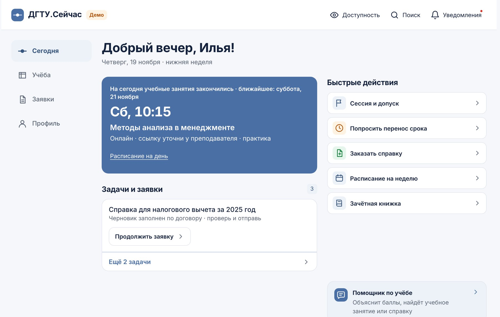

Как проходит сценарий

1. Илья открывает раздел «Сегодня» → «Задачи и заявки» → «Продолжить заявку» в черновике справки для налогового вычета;
2. Данные уже собраны по договору об оплате обучения. Илье остаётся проверить отчётный год и отправить заявку;
3. Сотрудник деканата открывает заявку и последовательно нажимает «Взять в работу» и «Сформировать PDF-справку»;
4. Илья получает уведомление, а файл справки доступен для скачивания в заявке.

Вместо обращения в разные отделы студент оформляет справку одной кнопкой и сам отслеживает статус заявки и результат.

В исходном состоянии демо у Ильи есть заполненный черновик. Если другой проверяющий его уже отправил, тот же путь начинается из раздела «Заявки» → «Новая заявка» → «Справка для налогового вычета».

## Сценарий 1 в мобильной версии (390 px) по шагам

Тот же сценарий на экране телефона шириной 390 px. Скриншоты сняты на опубликованном сайте. Шаги 1–3 и 5–7 видит Илья, шаг 4 видит сотрудник деканата.

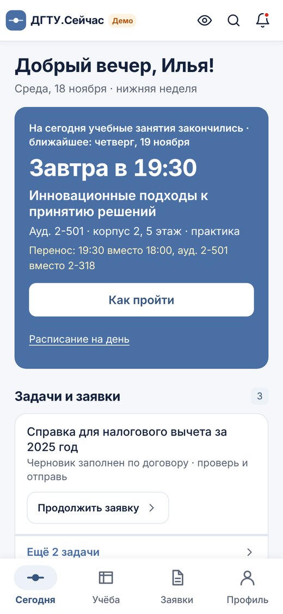

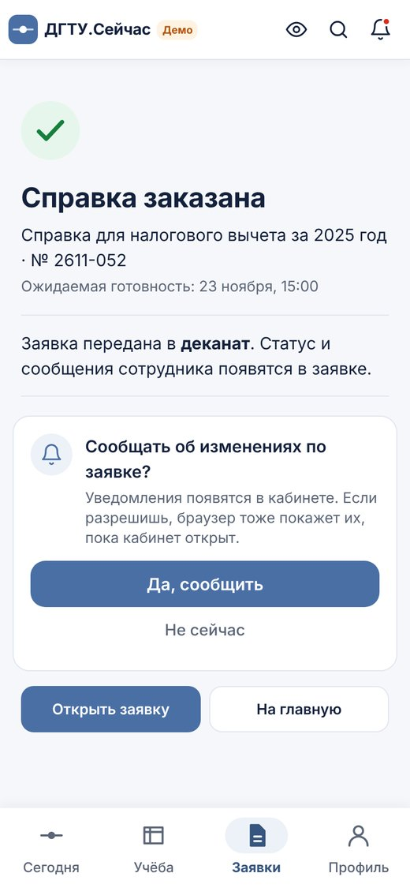

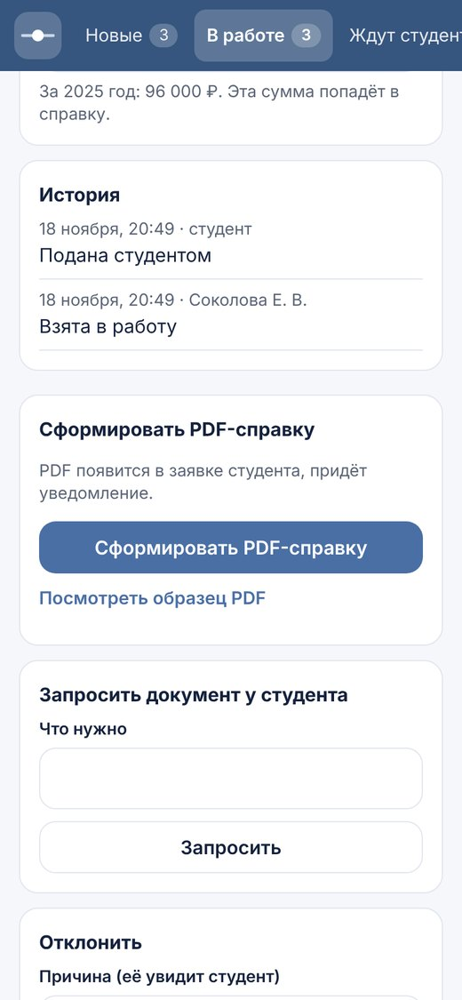

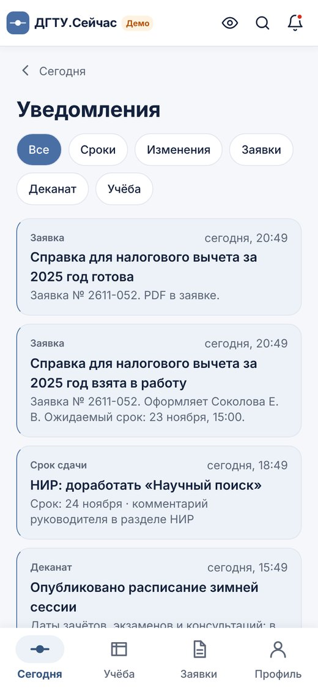

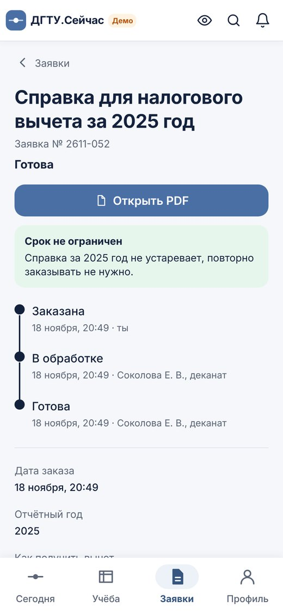

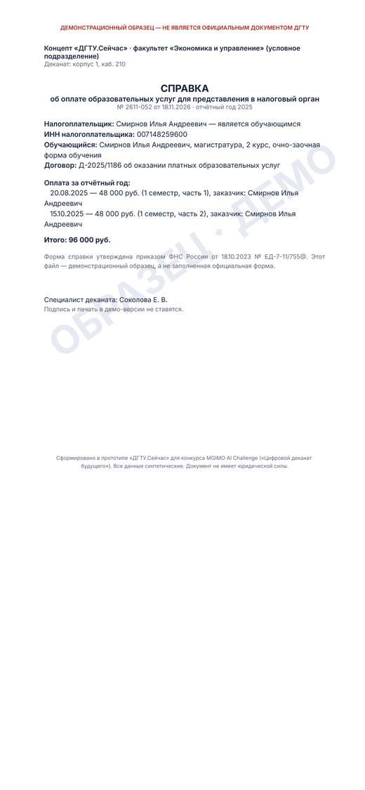

## Сценарий 2. Анна: от нехватки баллов к плану сдачи работ

Главная страница личного кабинета Анны. Первая задача: получить допуск к сессии по дисциплине «Бизнес-планирование». Кнопка «Разобраться» открывает разбор.

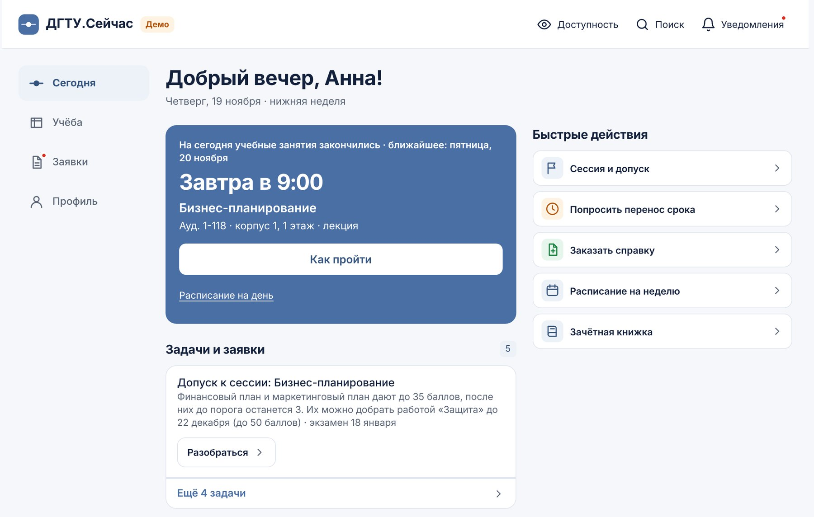

Разбор допуска: 12 из 50 баллов, не хватает 38 баллов. Если две просроченные работы примут на максимум, останется 3 балла. Их можно набрать на защите проекта, срок которой ещё не прошёл.

Маршрут: «Сегодня» → первая задача «Допуск к сессии: Бизнес-планирование» → «Разобраться». Остальные задачи открываются кнопкой «Ещё». Запасной вход: «Учёба» → «Оценки».

Кабинет показывает:

- расчёт баллов до допуска к экзамену;
- текст письма преподавателю, который Анна копирует и отправляет сама;
- план на 7 дней: несданные работы распределяются по свободным дням ближайшей недели без пересечения с учебными занятиями.

Ограничения названы прямо. Примет ли преподаватель просроченную работу, кабинет не знает. Отметка «Сделано» в плане не меняет баллы: их выставляет преподаватель.

## Как устроен помощник: алгоритм выбора ответа

Схема: расчёт программы → готовое правило → нейросеть GigaChat; без ключа или при ошибке API используется запасной ответ.

Помощник не переписывает один ответ несколько раз, а выбирает, кто отвечает. Сначала вопрос распознаётся по правилам. Если ответ можно посчитать точно (баллы, расписание, суммы, статусы, термины из словаря), отвечает программа. Если это известная ситуация без чисел, например как попросить отсрочку, отвечает готовое правило. Только свободный вопрос, который не подошёл ни под один случай, уходит в нейросеть GigaChat.

Почему числа считает программа, а не нейросеть

На раннем этапе нейросеть ошиблась в подсчёте. На вопрос о баллах Анны по бизнес-планированию она ответила «212 баллов», хотя правильный ответ 47 (12 + 20 + 15). После этого мы изменили распределение обязанностей. Баллы, расписание, даты, суммы и статусы берёт из базы и вычисляет программа. Нейросеть не называет баллы и не создаёт кнопки действий, их формирует сервер.

Справочные блоки и запасной ответ

Для свободного вопроса программа подбирает короткие справочные блоки по ключевым словам: правила вычета, перечень справок, словарь вузовских терминов. Это делает функция retrieveFacts в коде помощника, векторная база не используется. Баллы, платежи и статусы заявок в эти блоки не попадают. Нейросети передаются имя, курс, группа и последние сообщения диалога. Если GigaChat недоступен или ключа нет, помощник отвечает по запасным правилам.

## Проверки помощника: 14 из 14

Набор из 14 эталонных вопросов запускается одной командой: node scripts/evaluate-assistant.js. Проверка идёт без сети, на временной копии демо-базы и без ключа GigaChat, поэтому результат повторяется при каждом запуске. Эталоны и фактические ответы: docs/assistant-evals.json.

| Проверка | Что ожидалось | Результат |
| --- | --- | --- |
| Арифметика | 12 + 20 + 15 = 47, до порога 50 остаётся 3 | Пройдено |
| Два студента | Разные дневные и вечерние занятия. Илья не получает данные Анны | Пройдено |
| Оценки и НИР | Средний балл, сумма этапов НИР и недобор баллов | Пройдено |
| Справки | 96 000 × 0,13 = 12 480 ₽. Нельзя заказать справку за незакончившийся год | Пройдено |
| Правила и язык | Субсидия на ЖКУ без нейросети, словарь терминов, вопрос по-английски, письмо без отправки | Пройдено |
| Запасной ответ и справочные блоки | Неизвестный вопрос без ключа получает ответ. Баллы и суммы студента не попадают в справочные блоки | Пройдено |

Как распределились 14 вопросов:

- 11 вопросов с точным ответом программы: баллы, расписание, суммы, статусы, термины;
- 1 вопрос с ответом по готовому правилу;
- 1 вопрос без ключа GigaChat, на который помощник дал запасной ответ;
- 1 отдельная проверка, что баллы и суммы студента не попадают в справочные блоки для нейросети.

Эталонные ответы составлены по демо-данным и посчитаны вручную, а не взяты из проверяемой программы.

Чего эта проверка не показывает

14 из 14 не означает, что помощник безошибочен на любых вопросах. Ответы живой нейросети этим набором не оценивались. Права доступа и интерфейс проверяют 34 автотеста и прохождение сценариев в браузере. Налоговый пример проверяет арифметику демо-данных и не заменяет налоговую консультацию.

## Отзывы студентов: что помогает и что мешает

Прототип показали шести студентам разных уровней и форм обучения: бакалавриат, магистратура и аспирантура, очная и очно-заочная формы. Ниже их качественные отзывы.

| Респондент | Что сообщил о прототипе | Вывод для команды |
| --- | --- | --- |
| Аспирант | Все задания выполнены, оценка 5. Ближайшее занятие полезно, блок задач кажется лишним | Сохранить ближайшее занятие, сократить блок задач. |
| Бакалавриат, 2 курс | Все задания выполнены. Затруднение в задании «б», лёгкость остальных 3–4 из 5. Лишнего нет. Нужен переход в портфолио | Повторить задание «б» с наблюдением. |
| Бакалавриат, 1–2 курс | Все задания выполнены, оценка 5. Пользовалась помощником, вся главная страница полезна | Сохранить содержание главной. |
| Бакалавриат, 1–2 курс | Все три задания выполнены, оценка 5. Помощник помог с заданием. Хочется более интересного интерфейса | Улучшать иерархию и оформление. |
| Бакалавриат, 5 курс, очно-заочная форма | Все задания выполнены, оценка 5. Полезны расписание и быстрые действия. Блок «Следующий шаг» мешал. Ответ помощника о «Статистике» понятен | Убрать навязчивый блок, оставить одну видимую задачу. |
| Магистратура, очно-заочная форма | Прототип не оценивала. Рассказала о действующем кабинете: много вкладок, непонятные «Каталог» и «Журналы», уведомления о сроках пересдачи теряются среди новостей, справку об обучении ждать 3–5 дней и получать на бумаге | Сохранить четыре раздела и уведомления по темам. |

Что изменили после отзывов

Блок «Следующий шаг» заменили на «Задачи и заявки»: первая задача всегда видна, остальные открываются кнопкой «Ещё». Расписание и быстрые действия сохранили. Повторно студентов по новой главной странице ещё не опрашивали.

Проблемы действующего личного кабинета, которые назвали студенты

- не загружается QR-код;
- трудно найти остаток и сумму оплаты;
- справку для работы ждать 3–5 дней и забирать лично;
- много вкладок с непонятными названиями;
- сроки ликвидации задолженности теряются в потоке новостей;
- непонятно, куда обращаться по воинскому учёту.

Часть этих проблем решена в прототипе: электронная справка, уведомления по темам, четыре понятных раздела, справочная страница о воинском учёте с официальными контактами подразделения ДГТУ. Оплата и QR-код остаются задачами развития: платёжной интеграции в прототипе нет. Полные ответы: docs/feedback-quotes.md.

## Решаемая проблема и структура кабинета

Учебная жизнь студента разбросана по разным местам: расписание, объявления, справки и оценки требуют отдельных действий. Прототип отвечает на вопрос «что мне нужно сделать сейчас». Ближайшее занятие и задачи студента видны на главной странице, а остальные экраны ведут к конкретному результату.

| Обязательное ядро | Реализация |
| --- | --- |
| Вход и профиль | Логин и пароль. ФИО, факультет, направление, курс, группа. Два разных студенческих аккаунта и аккаунт сотрудника. |
| Расписание | День и неделя, преподаватель и аудитория. Изменение аудитории или перенос заметны в расписании и ведут на конкретную дату и занятие. |
| Успеваемость | Баллы, зачёты, экзамены, сессия и зачётная книжка. Разбор нехватки баллов и следующий шаг. |
| Заявки и справки | Подача онлайн, статус, сотрудник и срок. Запрос документа у студента, переписка и получение PDF. |
| Уведомления | Изменения расписания, сроки сдачи, заявки и объявления деканата. Лента с фильтрами и отдельные настройки. |

Четыре раздела: «Сегодня», «Учёба», «Заявки», «Профиль». На телефоне меню внизу экрана, на широком экране слева. Главная страница показывает по порядку ближайшее занятие, первую задачу, быстрые действия и помощника. Помощь собрана в «Профиле» в одном месте. Поиск в шапке находит разделы.

Стек и рост до всего вуза

Сервер на Node.js 22 и Express, страницы собираются на сервере, поэтому кабинет быстро открывается даже на слабом телефоне. Данные демо хранятся в SQLite, приложение запускается в Docker на Timeweb Cloud.

Что уже готово к росту:

- сессия хранится в подписанной cookie, поэтому серверов может быть несколько;
- экраны не обращаются к базе напрямую: при переходе на PostgreSQL меняются схема и запросы, но не интерфейс;
- расчёты помощника не нагружают нейросеть.

Что нужно для всего вуза:

- данные в PostgreSQL;
- файлы в S3-совместимом хранилище;
- лимиты входа в общем хранилище;
- расписание и оценки из выгрузок учётных систем вуза.

Нагрузочное тестирование не проводилось.

## Инструменты и их роли

Полный перечень ИИ-инструментов, сред разработки и сервисов, которые использовались в работе.

| Инструмент или сервис | Для чего использовался |
| --- | --- |
| Claude: чат, Design, Docs | Разбор задания и критериев. Исследование с веб-поиском: практики личных кабинетов вузов, материалы ФНС о вычете, тренды TikTok и VK для видео. Первые макеты и варианты дизайна в Claude Design. Концепция, требования, план работ и текст видео в Claude Docs. |
| Claude Code | Код приложения: сервер, база SQLite, PDF-справки, тесты, Dockerfile и исправления. 14 ноября версия для слабовидящих и помощник на английском. 17–19 ноября сверка с заданием, доработки по независимой проверке, это описание. |
| ChatGPT, Codex | Независимые проверки работы. 16 ноября Codex Desktop также доработал интерфейс и русские тексты, проверил код и публикацию. |
| Cursor | Вместе с Codex Desktop доработки 15–17 ноября: разбор допуска и план на 7 дней, главная страница, студенческий билет, тексты интерфейса. |
| Независимый агент-проверяющий (Codex) | Аудит всех разделов до правок, отдельная проверка изменений после реализации, подтверждение исправлений. |
| Навыки Codex | Impeccable для интерфейса, redaktura для русского текста, Sites для выбора хостинга, PDF для сборки и проверки описания. |
| Браузер и Playwright | Скриншоты, переходы, заполнение форм, проверка размеров экрана и крупного шрифта. |
| GigaChat API | Ответы помощника на свободные вопросы. Расчёты и правила работают без нейросети. Если API недоступен, помощник отвечает по запасным правилам. |
| Node.js test runner, Git | 34 автотеста, история изменений и передача проверенного кода. |
| GitHub, Timeweb Cloud | Репозиторий, HTTPS и размещение сайта. Обновление основной ветки автоматически публикует сайт. |
| Python, ReportLab, pypdf, Poppler, FFmpeg | Сборка и проверка этого PDF, монтаж видео из селфи капитана и записи экрана с субтитрами. Шрифт Inter в интерфейсе и материалах. |

Растровые иллюстрации нейросетью не генерировались, логотип и значки нарисованы кодом (SVG). Лицензии: docs/third-party-notices.md.

## Промпты по этапам

Суть ключевых постановок задач по этапам (полный журнал: docs/prompts.md). Запросы последних этапов приведены дословно в разделе «Запросы дословно».

| Этап | Постановка задачи | Результат |
| --- | --- | --- |
| Разбор задания | «Посмотри задание и составим план работ» | Ядро, ограничения и план. |
| Сценарии | «Путь клиента по Jobs to be done…» | Идея раздела «Сегодня» и связанные переходы. |
| Макеты | «Рисуй учёбу», диалог с помощником и раздел помощи | Первые варианты, затем отказ от части разделов. |
| Проверка | «Собери пакет… другому агенту» | Независимые замечания и исправления. |
| Основной сценарий | «Я бы выбрала… справку для налогового вычета» | Путь от заявки до PDF. |
| Практика вуза | Справка только за закончившийся год | Правило в форме, на сервере и в тесте. |
| Интерфейс, 16–17 ноября | Русский язык кабинета, «Профиль», полировка текстов | Рабочие зоны, честные формулировки, блок «Задачи и заявки». |
| Главная после отзывов | «Исправь выявленные проблемы» | Вычет и допуск наверху, без дублей раздела помощи. |
| Публикация | «Да, опубликовать на сайте» | Публикация через GitHub на Timeweb, проверка живого сайта. |
| Материалы | «Обнови сопроводительный документ» | PDF и комментарий согласованы с сайтом. |
| Доступность, 14 ноября | «Что делать со студентами, которые плохо говорят по-русски… версия для слабовидящих?» | Версия для слабовидящих и помощник на английском, тесты. |
| Палитра | «Пришли варианты синего… чуть не такой яркий» | Шесть вариантов на фрагменте экрана, выбран приглушённый синий. |
| Подготовка к сессии | Предложение второго агента: «От предупреждения к действию» | Разбор допуска, письмо преподавателю, план на 7 дней. Цифры GigaChat не считает. |
| Сверка, 17 ноября | «Сделай сверку с заданием, с брифом… что недоделано» | Документ сверки и план работ. Кнопка заказа под расчётом вычета, пакет справок у деканата, срок действия справки. |
| Тексты, 17–18 ноября | «Не пары, а учебные занятия», «перефразировать, чтобы не было тире», «синтетические данные» | Тексты кабинета переписаны, автотест следит, чтобы тире не вернулись. |
| Видео | «Какие сейчас тренды… для визуального контента», текст для капитана | Сценарий: селфи капитана, запись экрана, субтитры, без сгенерированных людей. |

Файлы для ИИ-агентов

Каждый агент (Claude Code, Codex, Cursor) начинает работу с этих файлов. Они задают правила, формат проверки и критерии приёмки, поэтому агенты работали по одним правилам и проверяли друг друга.

| Файл | Для чего агенту |
| --- | --- |
| CLAUDE.md, AGENTS.md | Неизменяемые правила: только синтетические данные, права проверяет сервер, ключи только в переменных окружения, числа считает программа, честные обещания, мобильная версия от 360 px. Порядок работы: маленькие шаги, тест, проверка живого сайта. |
| docs/review-prompt.md | Шаблон задания второму агенту для независимой проверки: что проверить и в каком виде вернуть замечания. |
| docs/reviews.md | Журнал найденных ошибок ИИ: кто нашёл, как исправили, чем проверили. |
| docs/prompts.md | Ключевые постановки задач по этапам. |
| test/app.test.js | 34 автотеста как критерии приёмки: агент не сдаёт работу, пока тесты не проходят. |
| scripts/evaluate-assistant.js | 14 эталонных вопросов помощнику без сети: проверка, что факты считает программа. |
| docs/submission-checklist.md, docs/hosting-runbook.md | Сверка с требованиями конкурса и план дежурства за сайтом до 28 ноября. |

## Запросы дословно

Как ставились задачи на последних этапах: реплики команды без правки, сокращения отмечены «…». Голосовые сообщения распознаны автоматически, поэтому язык разговорный.

| Когда | Запрос | Что сделал агент |
| --- | --- | --- |
| 10 ноября, старт | «Можем ориентироваться на наш личный кабинет ДГТУ и собрать лучшие практики вузов… Давай посмотри задание, есть ли у тебя доступ к нему, и составим план работ, что тебе требуется для выполнения этого» | Не смог открыть закрытое задание и не стал вводить пароль. Попросил войти самостоятельно и составил план. |
| Палитра | «Ты можешь мне прислать варианты синего еще… Мне хочется чуть-чуть не такой яркий синий… Можешь мне прислать палитру?» | Шесть вариантов на фрагменте экрана, выбран приглушённый синий. |
| Доступность | «Так, берем инклюзивный, слабовидящих, и давай второй вариант работы… хотя бы сделаем какой-то помощник или еще что-то, небольшую часть пока.» | Версия для слабовидящих и помощник на английском, факты считает программа. |
| 17 ноября, сверка | «Посмотри последние версии по задаче, по личному кабинету, курсор заканчивал их… сделай сверку с заданием, с брифом… Давай составим пока резюме и план работ.» | Документ сверки и план работ в Claude Docs. |
| 17 ноября, правки | «Делаем доработки, исправляем ошибки. Воинский учет оставляем настоящий адрес, телефон, часы работы. Оставляем как есть.» | Первый экран вычета, пакет справок у деканата, срок справки. Контакты подразделения оставлены как есть. |
| 17 ноября, тексты | «на сайте личного кабинета появились изменения. нужно перефразировать в кабинете так, чтобы не было тире нигде» | Тексты 27 страниц переписаны, автотест следит за тире. |
| 18 ноября, термин | «Слово вымышленный не нравится. Может, синтетические лучше называть…» | «Синтетические данные» на сайте, в PDF и в правилах для агентов. |
| 18 ноября, проверка | «собери пакет проверки» | Архив для независимого агента. Задание: docs/review-2026-11-18-task.md. |
| 18 ноября, разбор | «Можешь идти по списку: принять / отклонить с причиной — запишу в журнал.» | 15 замечаний разобраны по одному, решения в docs/reviews.md. |

## Как находили ошибки ИИ

| Случай | Кто и как обнаружил | Исправление |
| --- | --- | --- |
| GigaChat: «в понедельник занятий нет», хотя их три | Регрессионная проверка Claude | Расписание на любой день считает программа, нейросети запрещено называть факты. Тест. |
| GigaChat перевернул определение «академической разницы» | Проверка живого сайта | Термины берутся из словаря без нейросети. Тест. |
| Сброс демо был доступен без входа | Регрессионная проверка | Только после входа и с подтверждением. Тест. |
| Чат помощника блокировал кнопку после первого вопроса | Прогон в Playwright | Защита от двойной отправки не трогает чат. |
| Обещание «анонимной поддержки» | Сверка с правилом честных обещаний, 17 ноября | Формулировка убрана: кабинет анонимность не обеспечивает. |
| Нейросеть насчитала 212 баллов вместо 47 | Второй агент, ранний журнал | Расчёты переданы программе, добавлен тест. |
| Справка за текущий год | Команда, практика вуза | Ограничение года в форме, на сервере и в тесте. |
| Уведомление ведёт не на тот день | Независимая проверка | Ссылка на дату и конкретное занятие. |
| Настройки молчат при сбое сети | Проверка 16 ноября | Состояния «Сохраняем», успех, ошибка и повтор. Проверено остановкой сервера. |
| После заявления обещается справка | Проверка 16 ноября | Подтверждение учитывает вид обращения. |
| GigaChat придумал раздел «Финансы и оплата» и писал «пары» | Независимая проверка 18 ноября | Ответ об оплате даёт программа. В промпте список настоящих разделов и «учебные занятия». |
| Помощник советовал заказать уже выданную справку на вычет | Независимая проверка 18 ноября | Ответ учитывает год из вопроса и заявки студента, форма не предлагает заказанный год. Тест. |
| «До порога останется 3» без учёта защиты проекта на 50 баллов | Независимая проверка 18 ноября | Кабинет и помощник показывают работы, срок которых ещё не прошёл. Тест. |

Каждое замечание оценивалось отдельно: принять, отклонить с причиной или уточнить у команды. Полный журнал: docs/reviews.md.

## Мобильная версия: главная страница

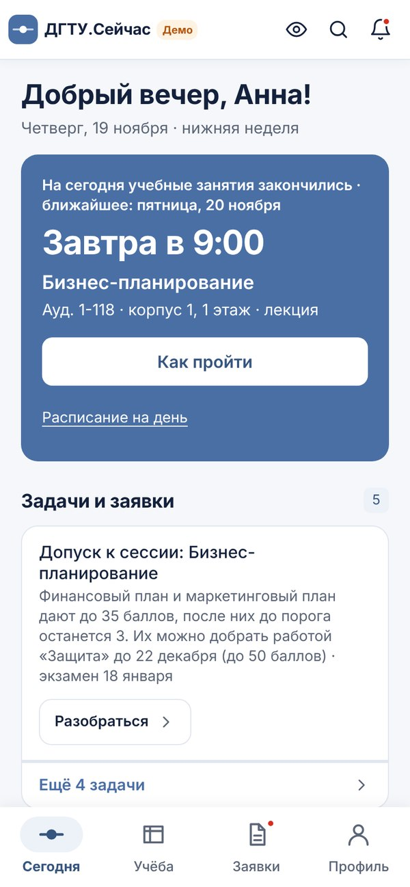

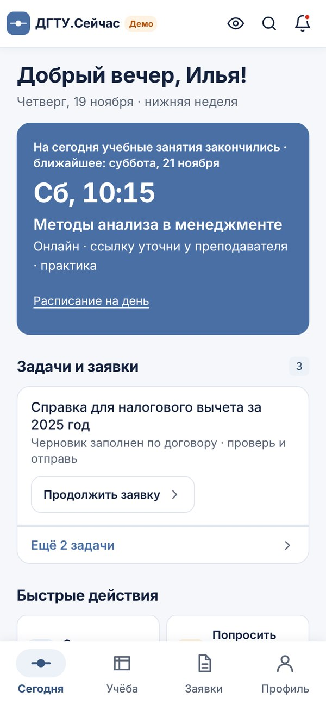

Проверено на ширине экрана 360 и 390 px, в том числе в версии для слабовидящих: горизонтальной прокрутки нет. Физический телефон и экранный диктор отдельно не проверялись.

## Доступность: для слабовидящих и иностранных студентов

Кабинет рассчитан и на слабовидящих студентов, и на тех, для кого русский язык не родной.

- Версия для слабовидящих включается значком «глаз» в шапке, ссылкой на странице входа и в «Профиле». Текст крупнее, контраст выше, ссылки подчёркнуты, анимаций нет. Выбор запоминается в браузере;
- Все значки подписаны для экранного диктора;
- На вопрос по-английски помощник отвечает по-английски. Расписание, сессию, баллы, заявки, вычет и стипендию при этом по-прежнему считает программа. Интерфейс кабинета остаётся на русском, официальные справки выдаются только на русском, и помощник об этом предупреждает.

Доработки после сверки с заданием

- кнопка заказа справки для вычета стоит сразу под расчётом суммы, данные договора и ИНН свёрнуты;
- справки из жизненной ситуации деканат видит одной строкой «Пакет»;
- у готовой справки об обучении и о стипендии показано, до какого числа её обычно принимают (демо-правило: 30 дней). Пока срок не прошёл, новую заказать не предлагается.

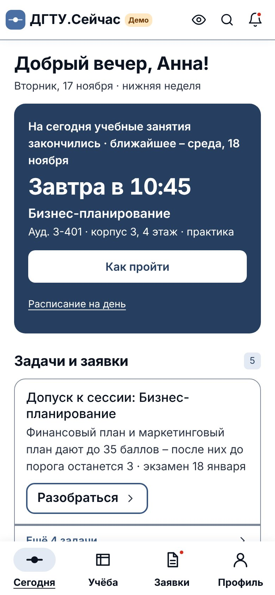

Кабинет деканата: две справки для субсидии на ЖКУ в одной строке «Пакет».

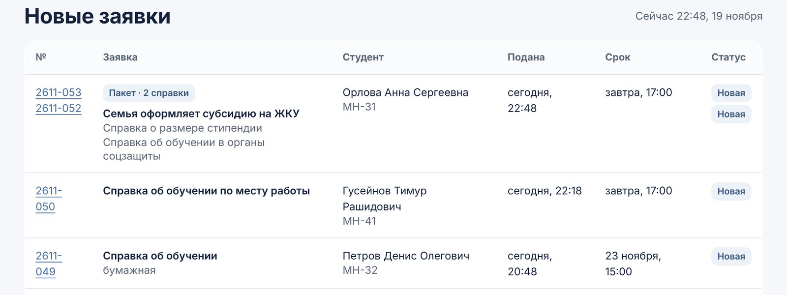

## Вход, данные и защита

Вход. В базе хранится хэш пароля (bcrypt), а не сам пароль. Пароли демо-аккаунтов опубликованы для жюри специально. После серии неудачных попыток вход временно ограничивается.

Сессия. Подписанная cookie содержит только идентификатор пользователя, сервер проверяет подпись. На сайте включены флаги HttpOnly, SameSite и Secure. Подпись не шифрует данные, поэтому сведения об учёбе в cookie не хранятся.

Права. При каждом запросе сервер проверяет роль пользователя и то, кому принадлежат заявка, файл и PDF. На чужие объекты сервер отвечает «не найдено» (ошибка 404), даже если подставить адрес вручную. Действия деканата доступны только сотруднику.

Хранение. Демо-данные лежат в SQLite, загруженные файлы хранятся на сервере под случайными именами. Принимаются PDF, JPG и PNG до 5 МБ. Прототип не подключён к системам ДГТУ. Все данные о студентах и преподавателях синтетические, то есть вымышленные: ни один человек, оценка или номер документа не взяты из настоящих систем.

ИИ. Ключ GigaChat и секрет сессии хранятся в переменных окружения сервера, их нет в коде и в браузере. Точные ответы о баллах, расписании, суммах и статусах формирует программа. Свободный вопрос может уйти в GigaChat вместе с последними сообщениями, именем, курсом, группой, формой обучения и справочными блоками. Баллы и статусы в эти блоки не включаются. Текст самого вопроса автоматически не обезличивается.

Границы прототипа

Прототип не связан с системами вуза и не выдаёт действительных справок. Уведомления браузера приходят, пока кабинет открыт, отправку на закрытый телефон мы не обещаем. Сброс демо-данных общий для всех проверяющих. Нагрузочное тестирование не проводилось.

Лицензии

Шрифт Inter распространяется по лицензии SIL OFL 1.1, полный текст приложен. Зависимости и их лицензии перечислены в docs/third-party-notices.md. Официальный логотип вуза не используется, логотип проекта и значки нарисованы кодом (SVG).

## Проверка и ручная работа

Что проверено

34 автотеста проверяют права доступа, сценарии справок, помощника (в том числе на английском), версию для слабовидящих, переключение демо-аккаунтов, первую задачу на главной странице, пакет справок у деканата, срок готовой справки и отсутствие тире в текстах 27 страниц. Все 34 проходят. Проверки помощника: 14 из 14 без сети.

Состояния интерфейса:

- пустые списки и дни без занятий подсказывают, что делать дальше;
- пустой фильтр уведомлений предлагает сбросить фильтр;
- страницы ошибок 404, 403 и 500 оформлены в стиле кабинета и ведут в меню;
- помощник показывает «Думаю…», а при обрыве связи сохраняет вопрос и кнопку «Повторить».

Оба сценария пройдены в браузере на опубликованном сайте. Размеры экрана эмулировались, жесты на физическом телефоне и экранный диктор отдельно не проверялись.

Что делала команда

- входила в действующий кабинет ДГТУ и кабинет конкурса сама, пароли ИИ не передавались;
- регистрировала и настраивала GitHub, Timeweb и GigaChat, вписывала ключи в настройки хостинга, при сбое автообновления запускала публикацию вручную;
- составила и разослала анкету, собрала ответы студентов;
- принимала решения: разделы, сценарий вычета, палитра, названия справок, «учебные занятия», тексты без тире, «синтетические данные»;
- передавала материалы между агентами и решала, какие замечания принять;
- капитан записывает селфи и голос для видео и отправляет работу.

ИИ написал код, провёл проверки, записал экран, смонтировал видео и подготовил это описание.

Комплект для подачи

Ссылка на прототип и тестовые аккаунты в комментарии к работе, исходный код на GitHub, это описание со скриншотами и видео около 110 секунд: капитан в селфи, затем запись экрана живого сайта с её голосом и субтитрами. Сайт размещён в Москве на Timeweb Cloud, открывается из России без VPN и будет доступен до 28 ноября.

## История макетов: как выбирали решение

Макеты из прежних материалов команды показывают решения до нынешнего интерфейса. Остальные материалы сохранены в docs/screenshots.

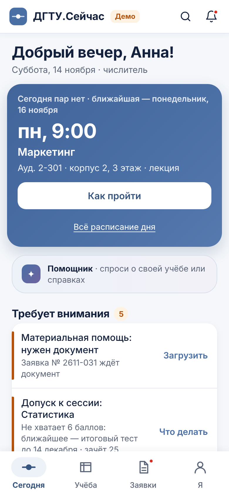
