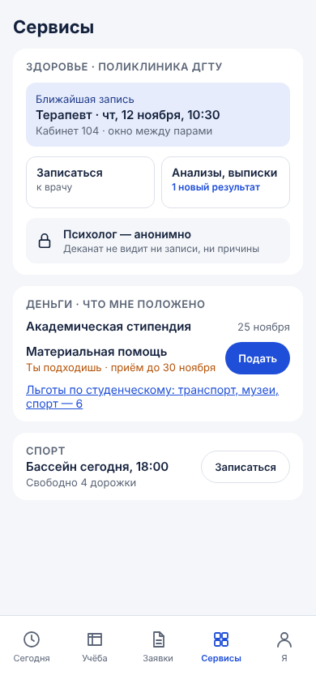
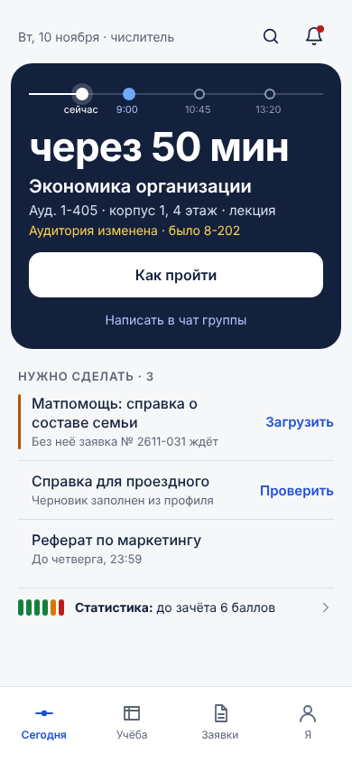
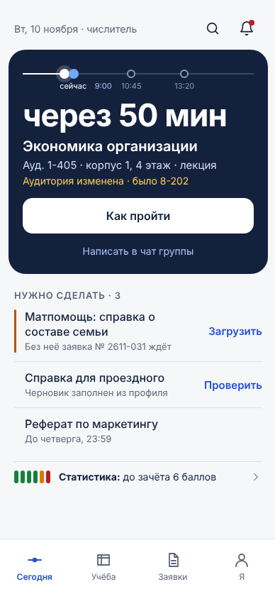
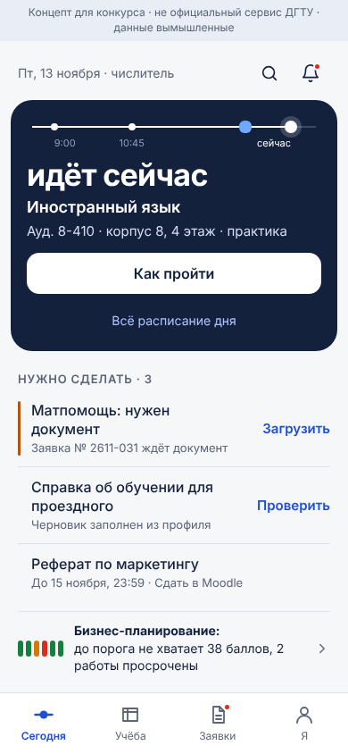
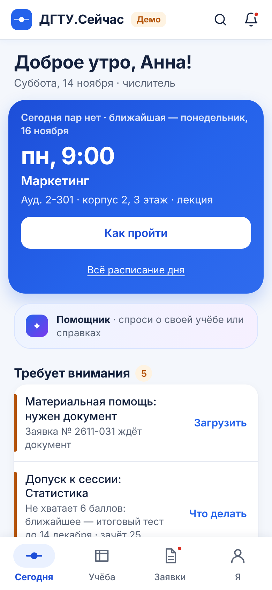
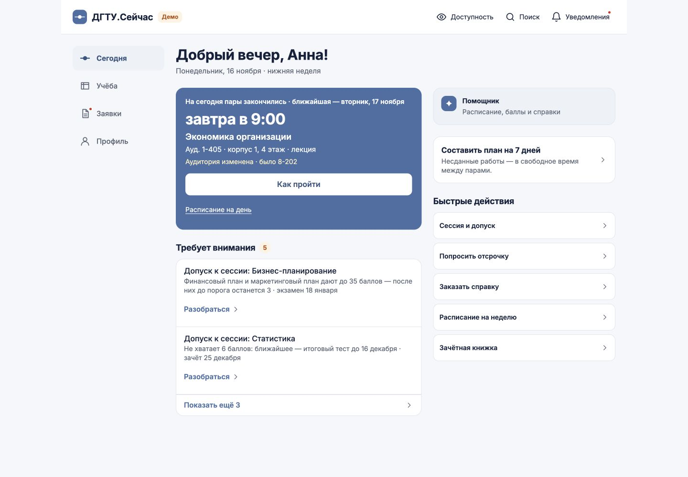
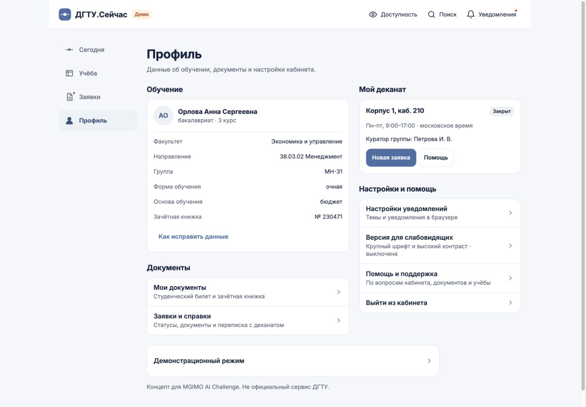
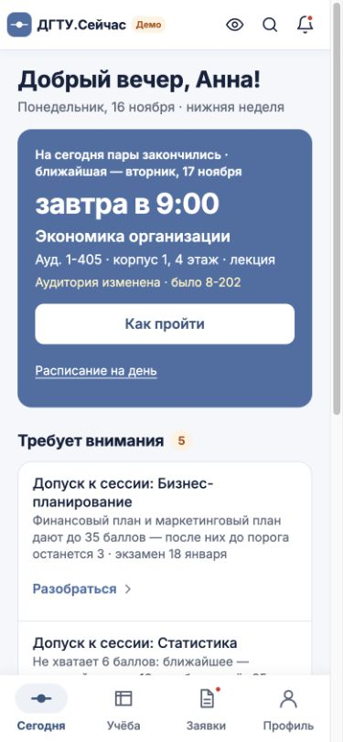

# ДГТУ.Сейчас

Цифровой деканат будущего
Описание процесса создания с помощью ИИ

Капитан команды: Ксения Игоревна Палеева.
Версия материалов: 16 ноября 2026 года.

Кабинет помогает студенту понять, что происходит с учёбой и какой следующий шаг нужен: где ближайшая пара, хватает ли баллов, за кем действие по заявке.

Концепт для MGIMO AI Challenge. Не официальный сервис ДГТУ. Все данные студентов, преподавателей, оценок и документов в прототипе вымышленные.

Прототип: https://zabava204-dgtu-seychas-e35f.twc1.net/
Исходники: https://github.com/zabava204/dgtu-seychas
Проверенная опубликованная версия интерфейса: 2c3c753.

| Аккаунт | Что показывает |
| --- | --- |
| anna / demo2026 | Бакалавриат, 3 курс, бюджет. Дневные пары, баллы и допуск. |
| ilya / demo2026 | Магистратура, 2 курс, договор. Вечерние пары, НИР и справка для вычета. |
| dekanat / demo2026 | Рабочее место сотрудника: очередь, документы, переписка и PDF. |

На странице входа есть кнопки демо-доступа. Данные общие для проверяющих. При необходимости сценарий возвращается к началу через «Профиль» → «Демонстрационный режим»; сброс затрагивает все демо-аккаунты.

Содержание

Проблема и обязательное ядро; два сценария; инструменты; промпты; работа с ошибками; история макетов; актуальные экраны; безопасность; ручная работа и проверка.

## 1. Проблема и структура кабинета

В прежних материалах команда зафиксировала разрозненные разделы действующего кабинета: расписание, объявления, справки и оценки требуют отдельных действий. Для прототипа выбрана задача «что сделать сейчас»: ближайшее занятие и действия студента видны на главной, остальные экраны ведут к конкретному результату.

| Обязательное ядро | Реализация |
| --- | --- |
| Вход и профиль | Логин и пароль; ФИО, факультет, направление, курс, группа. Два разных студенческих аккаунта. |
| Расписание | День и неделя, преподаватель и аудитория. Изменение ведёт на конкретную дату и пару. |
| Успеваемость | Баллы, зачёты, экзамены, сессия и зачётная книжка. Разбор недобора и следующий шаг. |
| Заявки и справки | Подача, статус, сотрудник и срок; запрос документа, переписка и получение PDF. |
| Уведомления | Изменения расписания, сроки сдачи, заявки и объявления деканата. Лента и отдельные настройки. |

Четыре раздела: «Сегодня», «Учёба», «Заявки», «Профиль». На телефоне используется нижнее меню; от 840 px - боковое меню и более широкая рабочая область. Помощник доступен с главной, поиск в шапке находит разделы.

Реальный отзыв

В журнале есть один ответ аспиранта от 15 ноября. Это качественный отзыв, а не репрезентативный опрос. Респондент выполнил предложенные задания и отметил удобство времени следующей пары. Он также счёл счётчик до сессии информационным шумом. В текущем интерфейсе этот счётчик заменён переходом «Сессия и допуск».

Предложение убрать весь блок «Требует внимания» команда не приняла: он связывает главную с заявками и допуском. Новые отзывы в материалы не добавлялись. Источник: docs/feedback-quotes.md.

## 2. Два законченных сценария

Илья заказывает справку

1. Войти как ilya. Открыть «Заявки» → «Новая заявка» → «Справка для налогового вычета». Данные берутся из вымышленного договора; текущий незаконченный год недоступен.

2. Проверить год и данные, нажать «Заказать справку». Экран подтверждает отправку и ведёт в заявку.

3. Войти как dekanat. Открыть заявку Ильи в «Новых», нажать «Взять в работу», затем «Сформировать PDF-справку».

4. Вернуться как ilya. В «Заявках» появляется статус «Готова», ссылка на PDF и уведомление.

Это демонстрация документооборота. PDF имеет статус образца; налоговые суммы и сроки используются как демо-данные сценария.

Анна разбирается с допуском

1. Войти как anna. На «Сегодня» открыть «Разобраться» у дисциплины с недобором.

2. Проверить расчёт: набрано 12 из 50; не хватает 38; две работы дают до 35, после них останется ещё 3. Числа вычисляет программа.

3. Открыть подготовленный текст сообщения преподавателю. Его нужно скопировать и отправить самостоятельно - кабинет письма не отправляет.

4. Составить план на 7 дней: выбрать длительность и время дня. Задачи размещаются между парами. Отметка о выполнении не меняет баллы.

Дополнительный пример: в «Жизненных ситуациях» Анна выбирает справки для субсидии на ЖКУ. Кнопка «Заказать выбранные справки» соответствует выбору; при снятии всех флажков отправка недоступна.

## 3. Инструменты и их роли

Первые этапы ниже описаны по существовавшему журналу команды и прежнему PDF. Этап 16 ноября подтверждается текущим чатом, диффом, результатами тестов и проверкой опубликованного сайта. Версии моделей, которых нет в журнале, не приписываются.

| Инструмент / сервис | Применение |
| --- | --- |
| Claude: чат, Design, Docs | Разбор задания, исследование, первые макеты и варианты дизайна, концепция, требования и описание. |
| Claude Code | Первоначальный код приложения, сервер, SQLite, PDF, тесты, Dockerfile и исправления. |
| ChatGPT / Codex | Предыдущие независимые ревью. На этапе 16 ноября Codex Desktop также реализовал UX/UI и русские тексты, проверил код и публикацию. |
| Независимый Codex-субагент | Аудит всех разделов до правок; отдельное ревью диффа после реализации; подтверждение исправлений. |
| Навыки Codex | Impeccable - интерфейс; redaktura - русский текст; Sites - проверка способа размещения; PDF - сборка и визуальная проверка этого описания. |
| Браузер CUA / Playwright API | Скриншоты, переходы, формы, размеры экрана, проверки крупного шрифта. Ранее Playwright также использовался через агента. |
| GigaChat API | Свободные вопросы помощника. Расчёты и уверенные правила выполняются без модели; при недоступном API работают запасные правила. |
| Node.js test runner / Git | 28 автотестов; дифф, история коммитов и передача проверенных изменений. |
| GitHub / Timeweb Cloud | Репозиторий, HTTPS и размещение сайта; обновление main запускает развёртывание. |
| Python / ReportLab / pypdf / Poppler | Текст, сборка PDF, извлечение ранних скриншотов, рендер и проверка страниц. Inter используется в интерфейсе и PDF. |

При последней доработке сервис Sites не использовался для публикации: существующий сайт размещён на Timeweb. Новые растровые иллюстрации не генерировались. Полный список сторонних зависимостей и найденные тексты лицензий приложены в docs/licenses и docs/third-party-notices.md.

## 4. Промпты по этапам

Формулировки ранних запросов приведены в сокращённой передаче из docs/prompts.md. Это журнал ключевых постановок задач, а не полная стенограмма. Последние запросы и задача независимому агенту зафиксированы в текущем чате.

| Этап | Постановка задачи | Результат |
| --- | --- | --- |
| Разбор задания | «Посмотри задание и составим план работ» | Ядро, ограничения и план. |
| Сценарии | «Путь клиента по Jobs to be done…» | Идея «Сегодня» и связанные переходы. |
| Макеты | «Рисуй учёбу», диалог и помощь | Первые варианты; затем отказ от части разделов. |
| Проверка | «Собери пакет… другому агенту» | Независимые замечания и исправления. |
| Основной сценарий | «Я бы выбрала… справку для налогового вычета» | Путь от заявки до PDF. |
| Практика вуза | Справка только за закончившийся год | Правило в форме, сервере и тесте. |
| UX/UI, 16 ноября | «Каждый раздел проанализовал… русский язык, принятый в приложениях… правильное название… поясняющий текст» | Рабочие зоны, «Профиль», русские подписи, состояния форм. |
| Независимое ревью | «Проведи самостоятельный аудит… Код не меняй» | Список приоритетов, затем отдельная проверка диффа. |
| Публикация | «Да, опубликовать на сайте» | Коммит 2c3c753 в main и проверка живого сайта. |
| Материалы | «Посмотри задание» → «выполняй» | Согласование описания с опубликованным кабинетом. |

Правила для агентов находятся в CLAUDE.md и AGENTS.md: вымышленные данные, серверные права, ключи в окружении, числа вычисляет программа, обязательная проверка мобильной версии. Шаблон независимой проверки: docs/review-prompt.md.

## 5. Как находили ошибки ИИ

| Случай | Кто / как обнаружил | Исправление |
| --- | --- | --- |
| 212 баллов вместо 47 | Второй агент; прежний журнал | Расчёты переданы программе, добавлен тест-регрессия. |
| Справка за текущий год | Человек; практика вуза | Ограничение года в форме, сервере и тесте. |
| Уведомление ведёт не на тот день | Независимая проверка | Ссылка на дату и конкретную пару. |
| Настройки молчат при сбое сети | Аудит 16 ноября | Состояния «Сохраняем», успех, ошибка и повтор. Проверено остановкой сервера. |
| Количество справок не совпадает с флажками | Аудит 16 ноября | Постоянная точная подпись, блокировка пустого выбора. |
| После заявления обещается справка | Аудит 16 ноября | Подтверждение учитывает вид обращения. |
| Нет кнопки, но JS обращается к ней | Ревью нового диффа | Проверка существования кнопки. Повторный вход после заказа проверен без ошибок. |
| Повтор вопроса удаляет его во время другого запроса | Ревью нового диффа | Проверка состояния ожидания до удаления сообщений. |
| Два вложенных main на странице ошибки | Ревью нового диффа | Один основной ориентир; проверка страницы 404. |

Каждое замечание оценивалось отдельно. Предупреждение анализатора о шрифте Inter отклонено: шрифт уже использовался в проекте и подходит рабочему интерфейсу. Все три регрессии, найденные при последнем ревью, исправлены; независимый агент подтвердил исправления.

Полный журнал: docs/reviews.md. Сводные числа из прежнего PDF не переносятся как актуальные: в текущем этапе появились дополнительные случаи.

## 6. От идеи к рабочему прототипу

Исторические изображения извлечены из прежнего PDF команды. Они показывают ранние решения и не описывают текущий интерфейс. Даты ранних этапов взяты из того же журнала.

## 7. Выбор визуального решения

История 13-14 ноября из прежнего описания: команда сравнивала варианты на экране. Решение человека - светлый интерфейс и приглушённый синий.

## 8. Опубликованный кабинет: компьютер

16 ноября. Действующий сайт после публикации 2c3c753; ширина проверки 1440 px.

Боковое меню остаётся на месте. В основной колонке видны ближайшее занятие и вопросы, требующие действия. Справа - помощник, план и быстрые переходы. Действия не скрыты в горизонтальной ленте.

Приглушённый синий и шрифт сохранены. Возврат со вложенного экрана подписан названием родительского раздела. Стрелка раскрытия показывает, где можно увидеть детали. Лента уведомлений и её настройки названы по-разному.

## 9. Профиль и документы

Актуальный профиль на опубликованном сайте: обучение, документы, деканат, настройки и помощь.

Раздел «Я» переименован в «Профиль». Документы собраны в одном месте; контакты деканата отделены от настроек. Сброс общих демо-данных спрятан в раскрываемый блок с пояснением последствий.

В документах доступны демонстрационные PDF студенческого билета и зачётной книжки. Эти файлы не заменяют настоящие документы вуза.

## 10. Телефон: основные действия рядом

Опубликованная версия на 390 px. Нижнее меню и одноколоночная рабочая область.

Анна: проверены 19 экранов на 360 px в обычной версии и с крупным шрифтом. Илья: 15 экранов на 390 px и 11 экранов с крупным шрифтом. Горизонтальная прокрутка страницы в этих проверках не обнаружена.

## 11. Вход, данные и защита

Вход. В базе хранится хэш bcrypt, а не исходный пароль. Пароли демо-аккаунтов опубликованы для жюри специально. После серии неудачных попыток применяется временное ограничение входа.

Сессия. Подписанная cookie содержит идентификатор пользователя; сервер проверяет подпись. В продакшене заданы HttpOnly, SameSite и Secure. Подпись не является шифрованием, поэтому сведения об учёбе в cookie не кладутся.

Права. Сервер проверяет роль и принадлежность заявки, файла и PDF при запросе. Чужие объекты отвечают «не найдены». Действия деканата доступны роли сотрудника. Проверки не ограничиваются тем, какие кнопки показал браузер.

Хранение. Демо-данные лежат в SQLite, загруженные файлы - на сервере под случайными именами. Принимаются PDF/JPG/PNG до 5 МБ. Прототип не подключён к настоящим системам ДГТУ. Все студенты и преподаватели в нём вымышленные.

ИИ. Ключ GigaChat и секрет сессии хранятся в окружении сервера. Точные ответы о баллах, расписании, суммах и статусах формирует программа; уверенные правила не переписываются моделью. Свободный вопрос может уйти в GigaChat вместе с последними сообщениями, именем, курсом, группой, формой обучения и справочными блоками. Автоматически баллы и статусы в эти блоки не включаются. Текст самого вопроса не обезличивается автоматически.

Границы прототипа

Нет интеграций с системами вуза и действительных справок. Уведомления браузера работают, пока кабинет открыт; отправка на закрытый телефон не обещается. Сброс демо общий. Нагрузочное тестирование на тысячах студентов не проводилось. Для нескольких экземпляров приложения потребуются общие БД, файлы и лимиты запросов.

Лицензии

Inter распространяется по SIL OFL 1.1; полный текст приложен. Зависимости и найденные LICENSE/NOTICE перечислены в docs/third-party-notices.md. Официальный логотип вуза не используется; логотип проекта и иконки заданы SVG-разметкой.

## 12. Проверка и ручная работа

Что проверено

28 автотестов: закрытые страницы, неправильный пароль, чужие заявки/файлы/PDF, запрет действий деканата студенту, запрос с чужого сайта, оформление справки, загрузка документов, расчёты и ответы помощника. Последний прогон после UI-правок - 28 из 28.

В браузере пройден путь Ильи от заказа до готового PDF и сценарий Анны с допуском. При отключённом локальном сервере настройки показывают ошибку; после восстановления кнопка «Повторить» сохраняет выбор. Проверены пустой выбор справок, повторный вход после заказа и страница 404. После публикации проверены четыре основных раздела на сайте; ошибок консоли не обнаружено.

Браузерные размеры эмулировались: это не проверка сенсорных жестов на физическом устройстве. Экранный диктор и системные разрешения уведомлений отдельно не проверялись. Более ранний журнал команды содержит ручную проверку из России с телефона без VPN; последняя проверка выполнена встроенным браузером.

Что делал человек

По прежнему журналу: входил в реальные кабинеты, настраивал и оплачивал сервисы, задавал ключи в хостинге; выбирал разделы, основной сценарий, формулировки справок и палитру; передавал материалы на независимые проверки. В текущем этапе человек поставил задачу UX/UI, разрешил публикацию и подтвердил капитана команды. ИИ выполнил код, проверки и подготовку материалов. Видео в этом этапе не записывалось.

Комплект для подачи

Обязательное: ссылка и аккаунты в комментарии, исходники, этот PDF со скриншотами. Подготовлены комментарий и архив исходников. Видео до пяти минут необязательно; его сценарий приложен отдельно. Фактическую отправку работы выполняет капитан.

Перед подачей капитану нужно проверить доступ к исходникам для жюри и работоспособность сайта из России без VPN. По заданию хостинг должен оставаться доступным до 28 ноября; текущая публикация сама по себе не гарантирует будущую доступность.
