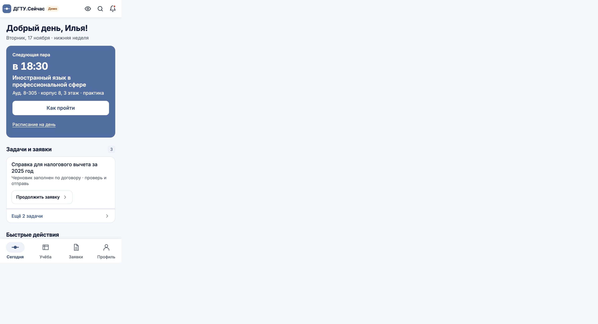
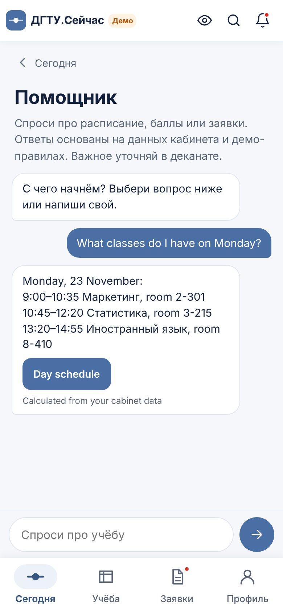
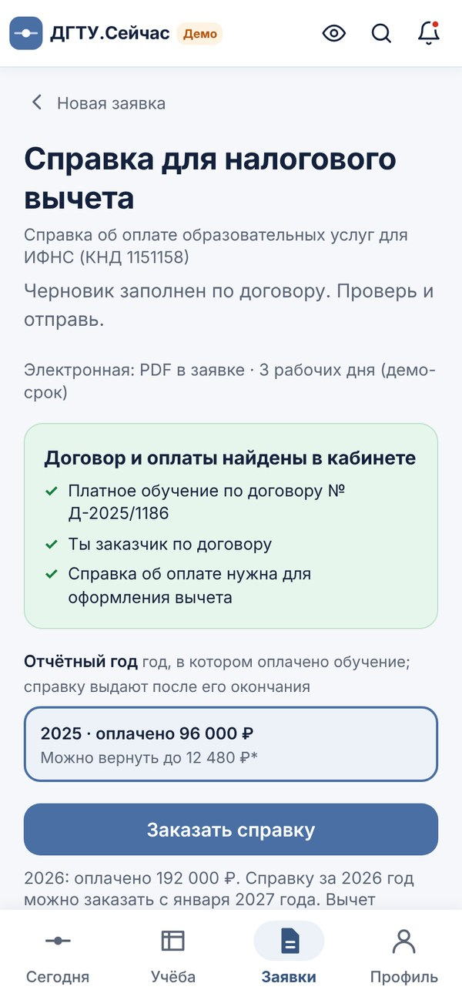
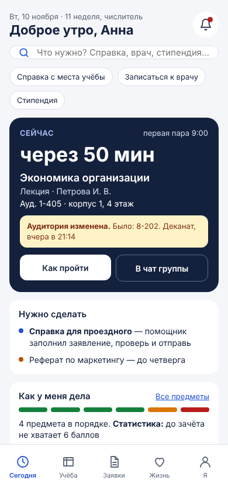

# ДГТУ.Сейчас

Цифровой деканат будущего
Описание процесса создания с помощью ИИ

Капитан команды: Ксения Игоревна Палеева.
Версия материалов: 17 ноября 2026 года.

Кабинет помогает студенту понять, что происходит с учёбой и какой следующий шаг нужен: где ближайшая пара, хватает ли баллов, за кем действие по заявке.

Концепт для MGIMO AI Challenge. Не официальный сервис ДГТУ. Все данные студентов, преподавателей, оценок и документов в прототипе вымышленные.

Прототип: https://zabava204-dgtu-seychas-e35f.twc1.net/
Исходники: https://github.com/zabava204/dgtu-seychas
Опубликованный код: 499efb6 (17.11, после сверки с заданием и правки текстов). На главной первая задача видна сразу: у Ильи — справка для вычета, у Анны — допуск к сессии; остальные задачи свёрнуты. Отзывы студентов бакалавриата, магистратуры и аспирантуры собраны 15–18 ноября.

| Аккаунт | Что показывает |
| --- | --- |
| anna / demo2026 | Бакалавриат, 3 курс, бюджет. Дневные пары, баллы и допуск. |
| ilya / demo2026 | Магистратура, 2 курс, договор. Вечерние пары, НИР и справка для вычета. |
| dekanat / demo2026 | Рабочее место сотрудника: очередь, документы, переписка и PDF. |

Демо-доступ есть на странице входа. Вверху «Профиля» и кабинета сотрудника можно переключить Анну, Илью и сотрудника без сброса данных. Данные общие для проверяющих. При необходимости сценарий возвращается к началу через «Профиль» → «Демонстрационный режим»; сброс затрагивает все демо-аккаунты.

Содержание

Два сценария; архитектура помощника; воспроизводимая оценка; отзывы студентов; обязательное ядро; инструменты и промпты; ошибки; безопасность; операционный план; история макетов.

## Илья: от задачи на главной до PDF

Опубликованная главная Ильи: первая задача — справка для вычета, кнопка «Продолжить заявку».

Илья открывает «Сегодня» → «Задачи и заявки» → «Продолжить заявку» у справки для вычета. Данные уже собраны по договору; остаётся проверить год и отправить. Этот маршрут доступен на опубликованном сайте.

Сотрудник открывает заявку → «Взять в работу» → «Сформировать PDF-справку». Илья получает файл в заявке и уведомление. Вместо похода между разными разделами виден путь, за кем действие и где результат.

Если черновика уже нет: «Заявки» → «Новая заявка» → справка для вычета. Перед повторным демо можно вернуть исходное состояние; сброс общих данных требует согласования с другими проверяющими.

## Анна: расчёт допуска становится действием

Опубликованная главная Анны: первая задача — допуск к сессии, кнопка «Разобраться».

Разбор допуска: 12 из 50, не хватает 38; после двух работ на максимум останется 3.

Маршрут: «Сегодня» → первая задача «Допуск к сессии: Бизнес-планирование» → «Разобраться». Остальные задачи — под «Ещё». Запасной вход: «Учёба» → «Оценки».

Кабинет показывает расчёт, текст просьбы преподавателю и план на 7 дней. Студент видит ограничения: примет ли преподаватель просроченную работу, кабинет не знает; отметка «Сделано» не меняет баллы. «Скопировано» и сообщение о создании плана уже реализованы.

## Как помощник выбирает ответ

Схема: calc → decision → llm; при отсутствии ключа или ошибке API используется fallback.

Это каскад выбора ответа, а не цепочка переписывания одного текста. Вопрос сначала распознаётся по правилам; exact-ответ (включая фиксированный словарь) возвращается из calc. Известная ситуация без exact получает decision. Только свободный вопрос other направляется в llm.

Почему числа вне модели

Прежняя ошибка «212 вместо 47» привела к изменению границы ответственности. Баллы, расписание, даты, суммы и статусы извлекает и вычисляет программа. Модель не назначает баллы и не создаёт кнопки-действия: их формирует сервер.

RAG-lite и отказоустойчивость

retrieveFacts выбирает короткие справочные блоки по вопросу. Это поиск по правилам, без векторной базы. Структурированные баллы, платежи и статусы не добавляются в эти блоки; имя, курс, группа и история диалога могут передаваться модели. Неуспешный вызов или отсутствие ключа возвращает запасной ответ по правилам.

Масштаб использования ИИ подтверждается также процессом: разработка, макеты, тексты, независимые ревью и исправленные ошибки. Наличие LLM внутри продукта само по себе не заменяет этих доказательств.

## Проверки помощника: 14 из 14

Воспроизводимый набор: node scripts/evaluate-assistant.js. Временная seeded SQLite, фиксированное время 16 ноября, 10:00 МСК; ключ удалён; http, https и fetch запрещены. Два прогона дали одинаковый JSON, сетевых попыток 0. Полный эталон и фактические ответы: docs/assistant-evals.json.

| Проверка | Пример независимого ожидания | Результат |
| --- | --- | --- |
| Арифметика | 12 + 20 + 15 = 47, до 50 остаётся 3 | Пройдено |
| Два студента | Разные дневные и вечерние пары; Илья не получает данные Анны | Пройдено |
| Оценки и НИР | Средний балл, сумма этапов и недобор по фиксированным данным | Пройдено |
| Справки | 96 000 × 0,13 = 12 480; запрет заказа за незаконченный год | Пройдено |
| Правила и язык | ЖКУ без LLM, словарь, английский вопрос, письмо без отправки | Пройдено |
| Fallback / retrieval | Неизвестный вопрос без ключа; специальные значения не уходят в справочные блоки | Пройдено |

Распределение: 11 calc, 1 decision, 1 fallback и 1 отдельная проверка retrieval. Эталоны зафиксированы по seed и независимой арифметике, не выводятся из проверяемой функции.

Границы результата

14/14 не означает точность на всех вопросах. Живой GigaChat и ветка llm не оценивались. Прямой вызов answer не проверяет HTTP-права и интерфейс: для них есть 32 автотеста и браузерный проход. Налоговый кейс проверяет арифметику демо-данных, а не полноту налоговой консультации.

## Отзывы студентов: польза и разногласия

Аспирант и три студентки из ответов 15–16 ноября; 17 ноября добавлен бакалавр 5 курса очно-заочной формы, 18 ноября — магистрант очно-заочной формы (ответил только о действующем кабинете). Два похожих ответа принадлежат разным людям — это подтвердил пользователь. Это качественные отзывы студентов разных уровней и форм обучения, а не статистическое исследование: мы смотрим, что помогает и что мешает, а не считаем доли.

| Респондент | Что сообщил о прототипе | Вывод для команды |
| --- | --- | --- |
| Аспирант | Все задания, 5; ближайшая пара полезна, блок внимания кажется шумом | Сохранить пару; снизить шум задач. |
| Бакалавриат, 2 курс | Все задания; затруднение в б, лёгкость 3–4; лишнего нет; нужен переход в портфолио | Повторить б с наблюдением. |
| Бакалавриат, 1–2 курс | Все задания, 5; использовала помощника, вся главная полезна | Сохранить полезное содержание. |
| Бакалавриат, 1–2 курс | Все три задания, 5; помощник для задания; хочется интереснее интерфейс | Улучшать иерархию и оформление. |
| Бакалавриат, 5 курс, очно-заочная | Все задания, 5; расписание и быстрые действия полезны; «Следующий шаг» мешал; ответ о «Статистике» понятен | Убрать навязчивый блок; оставить одну видимую задачу. |
| Магистратура, очно-заочная | Прототип не оценивала. В действующем ЛК: много вкладок, непонятные «Каталог» и «Журналы»; уведомления о сроках ликвидации задолженности теряются среди новостей; справка об обучении 3–5 дней, на бумаге | Сохранить четыре раздела и уведомления по темам; сроки пересдачи — в развитие. |

Что сделали после отзывов

«Следующий шаг» заменён на «Задачи и заявки»: первая задача всегда видна (вычет или допуск), остальные — под «Ещё». Расписание и быстрые действия сохранены. Повторный опрос людей по новой главной ещё не проводился; это доработка по замечаниям, а не подтверждённый ими результат.

Новые боли настоящего ЛК: не загружается QR-код, трудно найти остаток и сумму оплаты; справка для работы — 3–5 дней и получение очно (респонденты 5 и 6); много вкладок с непонятными названиями и поток новостей, в котором теряются сроки ликвидации задолженности (респондент 6). Это задачи развития, платёжной интеграции в прототипе нет. Причина затруднения в задании б пока не установлена. Полные ответы: docs/feedback-quotes.md.

Боль аспиранта учтена справочным навигатором воинского учёта, без оформления отсрочки. Официальный источник проверен 16.11.2026: https://www.donstu.ru/university/struktura/mobilizatsionnoye-upravleniye/

## Проблема и структура кабинета

В прежних материалах команда зафиксировала разрозненные разделы действующего кабинета: расписание, объявления, справки и оценки требуют отдельных действий. Для прототипа выбрана задача «что сделать сейчас»: ближайшее занятие и действия студента видны на главной, остальные экраны ведут к конкретному результату.

| Обязательное ядро | Реализация |
| --- | --- |
| Вход и профиль | Логин и пароль; ФИО, факультет, направление, курс, группа. Два разных студенческих аккаунта. |
| Расписание | День и неделя, преподаватель и аудитория. Изменение ведёт на конкретную дату и пару. |
| Успеваемость | Баллы, зачёты, экзамены, сессия и зачётная книжка. Разбор недобора и следующий шаг. |
| Заявки и справки | Подача, статус, сотрудник и срок; запрос документа, переписка и получение PDF. |
| Уведомления | Изменения расписания, сроки сдачи, заявки и объявления деканата. Лента и отдельные настройки. |

Четыре раздела: «Сегодня», «Учёба», «Заявки», «Профиль». На телефоне — нижнее меню; от 840 px — боковое. На «Сегодня» порядок: пара, первая задача, быстрые действия, помощник. Помощь в «Профиле» — один вход. Поиск в шапке находит разделы.

## Инструменты и их роли

Первые этапы ниже описаны по существовавшему журналу команды и прежнему PDF. Этап 16 ноября подтверждается текущим чатом, диффом, результатами тестов и проверкой опубликованного сайта. Версии моделей, которых нет в журнале, не приписываются.

| Инструмент / сервис | Применение |
| --- | --- |
| Claude: чат, Design, Docs | Разбор задания, исследование, первые макеты и варианты дизайна, концепция, требования и описание. |
| Claude Code | Первоначальный код приложения, сервер, SQLite, PDF, тесты, Dockerfile и исправления. 14 ноября — версия для слабовидящих и помощник на английском; 17 ноября — сверка с заданием и брифом, первый экран вычета, пакет справок у деканата, срок готовой справки. |
| ChatGPT / Codex | Предыдущие независимые ревью. На этапе 16 ноября Codex Desktop также реализовал UX/UI и русские тексты, проверил код и публикацию. |
| Cursor | Вместе с Codex Desktop — доработки 15–17 ноября: разбор допуска и план на 7 дней, главная, студенческий билет, тексты интерфейса и материалы для жюри. |
| Независимый Codex-субагент | Аудит всех разделов до правок; отдельное ревью диффа после реализации; подтверждение исправлений. |
| Навыки Codex | Impeccable - интерфейс; redaktura - русский текст; Sites - проверка способа размещения; PDF - сборка и визуальная проверка этого описания. |
| Браузер CUA / Playwright API | Скриншоты, переходы, формы, размеры экрана, проверки крупного шрифта. Ранее Playwright также использовался через агента. |
| GigaChat API | Свободные вопросы помощника. Расчёты и уверенные правила выполняются без модели; при недоступном API работают запасные правила. |
| Node.js test runner / Git | 32 автотеста; дифф, история коммитов и передача проверенных изменений. |
| GitHub / Timeweb Cloud | Репозиторий, HTTPS и размещение сайта; обновление main запускает развёртывание. |
| Python / ReportLab / pypdf / Poppler | Текст, PDF и проверка страниц. Pillow и FFmpeg (imageio-ffmpeg) - 50-секундная демонстрация по кадрам без озвучки. Inter - интерфейс и материалы. |

При последней доработке сервис Sites не использовался для публикации: существующий сайт размещён на Timeweb. Новые растровые иллюстрации не генерировались. Полный список сторонних зависимостей и найденные тексты лицензий приложены в docs/licenses и docs/third-party-notices.md.

## Промпты по этапам

Формулировки ранних запросов приведены в сокращённой передаче из docs/prompts.md. Это журнал ключевых постановок задач, а не полная стенограмма. Последние запросы и задача независимому агенту зафиксированы в текущем чате.

| Этап | Постановка задачи | Результат |
| --- | --- | --- |
| Разбор задания | «Посмотри задание и составим план работ» | Ядро, ограничения и план. |
| Сценарии | «Путь клиента по Jobs to be done…» | Идея «Сегодня» и связанные переходы. |
| Макеты | «Рисуй учёбу», диалог и помощь | Первые варианты; затем отказ от части разделов. |
| Проверка | «Собери пакет… другому агенту» | Независимые замечания и исправления. |
| Основной сценарий | «Я бы выбрала… справку для налогового вычета» | Путь от заявки до PDF. |
| Практика вуза | Справка только за закончившийся год | Правило в форме, сервере и тесте. |
| UX/UI, 16–17 ноября | Русский язык кабинета, «Профиль», полировка текстов | Рабочие зоны, честные формулировки, «Задачи и заявки». |
| Главная после отзывов | «Исправь выявленные проблемы» | Вычет и допуск сверху; без дубля помощи; 2075006. |
| Публикация | «Да, опубликовать на сайте» | main → Timeweb; проверка живого сайта. |
| Материалы | «Обнови сопроводительный документ» | PDF и комментарий согласованы с сайтом. |

Правила для агентов находятся в CLAUDE.md и AGENTS.md: вымышленные данные, серверные права, ключи в окружении, числа вычисляет программа, обязательная проверка мобильной версии. Шаблон независимой проверки: docs/review-prompt.md.

## Как находили ошибки ИИ

| Случай | Кто / как обнаружил | Исправление |
| --- | --- | --- |
| 212 баллов вместо 47 | Второй агент; прежний журнал | Расчёты переданы программе, добавлен тест-регрессия. |
| Справка за текущий год | Человек; практика вуза | Ограничение года в форме, сервере и тесте. |
| Уведомление ведёт не на тот день | Независимая проверка | Ссылка на дату и конкретную пару. |
| Настройки молчат при сбое сети | Аудит 16 ноября | Состояния «Сохраняем», успех, ошибка и повтор. Проверено остановкой сервера. |
| Количество справок не совпадает с флажками | Аудит 16 ноября | Постоянная точная подпись, блокировка пустого выбора. |
| После заявления обещается справка | Аудит 16 ноября | Подтверждение учитывает вид обращения. |
| Нет кнопки, но JS обращается к ней | Ревью нового диффа | Проверка существования кнопки. Повторный вход после заказа проверен без ошибок. |
| Повтор вопроса удаляет его во время другого запроса | Ревью нового диффа | Проверка состояния ожидания до удаления сообщений. |
| Два вложенных main на странице ошибки | Ревью нового диффа | Один основной ориентир; проверка страницы 404. |

Каждое замечание оценивалось отдельно. Предупреждение анализатора о шрифте Inter отклонено: шрифт уже использовался в проекте и подходит рабочему интерфейсу. Все три регрессии, найденные при последнем ревью, исправлены; независимый агент подтвердил исправления.

Полный журнал: docs/reviews.md. Сводные числа из прежнего PDF не переносятся как актуальные: в текущем этапе появились дополнительные случаи.

## Телефон: пара и первая задача рядом

Опубликованная главная на 390 px: после пары сразу задача вычета, затем быстрые действия.

После правок 17 ноября: Анна и Илья — эмуляция 360/390 px, в том числе с крупным шрифтом; горизонтальной прокрутки страницы не было. Физический телефон и экранный диктор отдельно не проверялись.

## Доступность и доработки 17 ноября

Кабинет рассчитан и на тех, кому трудно читать мелкий текст или по-русски. Версия для слабовидящих включается значком «глаз» в шапке, ссылкой на странице входа и в профиле: текст крупнее, контраст выше, ссылки подчёркнуты, анимаций нет, выбор запоминается в браузере. Все значки подписаны для экранного диктора. На вопрос по-английски помощник отвечает по-английски, а расписание, сессию, баллы, заявки, вычет и стипендию по-прежнему считает программа. Официальные справки — только на русском, и помощник так и говорит.

По итогам сверки с заданием и замечаниями эксперта: у вычета кнопка заказа стоит сразу под итогом, договор и ИНН свёрнуты; справки из жизненной ситуации деканат видит одной строкой «Пакет»; у готовой справки об обучении и о стипендии показано, до какого числа её обычно принимают (демо-правило: 30 дней), и пока срок не прошёл, новую заказать не предлагается.

Деканат: две справки для субсидии — одна строка «Пакет».

Проверено эмуляцией 360 и 390 px, в том числе в версии для слабовидящих; горизонтальной прокрутки нет. Физический телефон и экранный диктор отдельно не проверялись.

## Вход, данные и защита

Вход. В базе хранится хэш bcrypt, а не исходный пароль. Пароли демо-аккаунтов опубликованы для жюри специально. После серии неудачных попыток применяется временное ограничение входа.

Сессия. Подписанная cookie содержит идентификатор пользователя; сервер проверяет подпись. В продакшене заданы HttpOnly, SameSite и Secure. Подпись не является шифрованием, поэтому сведения об учёбе в cookie не кладутся.

Права. Сервер проверяет роль и принадлежность заявки, файла и PDF при запросе. Чужие объекты отвечают «не найдены». Действия деканата доступны роли сотрудника. Проверки не ограничиваются тем, какие кнопки показал браузер.

Хранение. Демо-данные лежат в SQLite, загруженные файлы - на сервере под случайными именами. Принимаются PDF/JPG/PNG до 5 МБ. Прототип не подключён к настоящим системам ДГТУ. Все студенты и преподаватели в нём вымышленные.

ИИ. Ключ GigaChat и секрет сессии хранятся в окружении сервера. Точные ответы о баллах, расписании, суммах и статусах формирует программа; уверенные правила не переписываются моделью. Свободный вопрос может уйти в GigaChat вместе с последними сообщениями, именем, курсом, группой, формой обучения и справочными блоками. Автоматически баллы и статусы в эти блоки не включаются. Текст самого вопроса не обезличивается автоматически.

Границы прототипа

Нет интеграций с системами вуза и действительных справок. Уведомления браузера работают, пока кабинет открыт; отправка на закрытый телефон не обещается. Сброс демо общий. Нагрузочное тестирование на тысячах студентов не проводилось. Для нескольких экземпляров приложения потребуются общие БД, файлы и лимиты запросов.

Лицензии

Inter распространяется по SIL OFL 1.1; полный текст приложен. Зависимости и найденные LICENSE/NOTICE перечислены в docs/third-party-notices.md. Официальный логотип вуза не используется; логотип проекта и иконки заданы SVG-разметкой.

## Проверка и ручная работа

Что проверено

32 автотеста: права, сценарии справок, помощник (в том числе на английском), версия для слабовидящих, переключение демо-аккаунтов, видимость первой задачи (вычет у Ильи, допуск у Анны), пакет справок у деканата и срок готовой справки. После доработок 17 ноября — 32 из 32. Evals помощника: 14/14 без сети.

В браузере пройдены путь Ильи до PDF и сценарий Анны с допуском; после публикации 2075006 сверены главные экраны на сайте. При отключённом сервере настройки показывают ошибку и «Повторить». Проверены пустой выбор справок и страница 404.

Размеры эмулировались: это не проверка жестов на физическом устройстве. Экранный диктор и системные разрешения уведомлений отдельно не проверялись. В журнале есть ранняя проверка из России без VPN; последняя — встроенным браузером.

Что делал человек

По журналу: входил в реальные кабинеты, настраивал хостинг и ключи; выбирал разделы, сценарий вычета и палитру; подтвердил капитана и публикацию; передал отзывы. ИИ выполнил код, проверки и это описание. Короткое видео — по кадрам локального прохождения, без озвучки, не непрерывная запись экрана.

Комплект для подачи

Обязательное: ссылка и аккаунты в комментарии, исходники, этот PDF со скриншотами. Подготовлены комментарий и архив исходников. В комплекте короткое видео и сценарий расширенной записи. Фактическую отправку работы выполняет капитан.

Перед подачей капитану нужно проверить доступ к исходникам для жюри и работоспособность сайта из России без VPN. По заданию сайт должен оставаться доступным до 28 ноября. План контроля, ответственный, ежедневный маршрут проверки и порядок восстановления: docs/hosting-runbook.md. Автоматический мониторинг не включён, баланс Timeweb владельцем ещё не подтверждён.

## Как выбирали решение: краткая история

Исторические макеты из прежнего PDF команды. Эти изображения показывают решения до нынешнего интерфейса; остальные материалы сохранены в docs/screenshots.

